# 01 Ryan: foundation and front door

Same format as the files of Neo, Sam and Collins. First read the Master file once, then do the **Common setup** (Part 1, Steps 0 to 9), **then** do Part 2 (your own work).

## 1. Your goal

Build the frame that every other screen lives in, and the door people come through: the app shell (sidebar, top bar, phone drawer, green-wave route change), the router, the session (sign-in, stay signed in, sign out, SACCO switcher), the error system wiring, the public pages, and account settings **including the Appearance card** (colour theme, font, text size for every person).

You do **not** depend on Sam or Neo. Their pages appear in your shell when their branches merge. Until then you test your shell with **placeholder pages** (Step R3).

## 2. Your files (only touch these)

```
index.html                         (fonts link, title)
src/main.jsx  src/App.jsx          (router + providers; main.jsx imports the three CSS files and calls applyAppearance())
src/shell/                         Shell.jsx Sidebar.jsx Topbar.jsx Drawer.jsx RouteTransition.jsx SaccoSwitcher.jsx
                                   Palette.jsx Bell.jsx PhotoViewer.jsx NetBanner.jsx RequireAuth.jsx PageBoundary.jsx
src/pages/public/                  Landing.jsx Intro.jsx Login.jsx Join.jsx Register.jsx Verify.jsx Forgot.jsx Reset.jsx
src/pages/account/                 AccountSettings.jsx  MySettings.jsx (places the shared AppearanceCard)
src/api/auth.js  src/api/session.js
src/mocks/ryan.js  src/styles/ryan.css  src/dev/registry.ryan.js
docs/frontend/done/ryan/
```

**Do not edit:** anything in `src/lib`, `src/components`, `src/mocks/data.js`, `src/styles/nexora*.css`, `src/styles/tailwind.css`, `src/dev/Harness.jsx`, `src/dev/main.jsx`. If one has a bug, tell Collins.

You own routing and the app entry. The router (`react-router-dom@7`) and Tailwind were installed in Setup Step 2.

## 3. Steps (do in order; each ends with a Check)

### R1. The app frame (Shell)

Picture: 

Build `Shell.jsx`: a fixed **sidebar** on screens 64 rem wide or more, a **sticky top bar** with page title, search button, bell and SACCO switcher, and a main area that scrolls. The sidebar has the NEXORA coin + wordmark at the top, the menu in the middle, and the profile (circle with initials, name, role) at the bottom. Menu items come from `menuFor(session.perms)` in `lib/perms.js`; each item has an icon, a title, and an active state (teal pill). Lay it out with Tailwind utilities and the shared classes `.side`, `.nav`, `.brand`, `.me` from `nexora.css`. The NEXORA coin and wordmark (`Logo.jsx`) belong here and on the public pages, and **nowhere else**: never on an error page, never as decoration.

How: copy the markup structure from `docs/frontend/prototype/index.html` and `app.js` (`renderSidebar`). The prototype is the exact reference.

Check: the colours come from Tailwind tokens (`bg-cream`, `text-ink`) so they change with the theme; on desktop the sidebar never scrolls away; with a short window (height 600) the menu fades at the bottom and scrolls inside the sidebar instead of cutting items; z-order is right (top bar above content, nothing overlapping the sidebar).

### R2. Phone and tablet

Pictures: 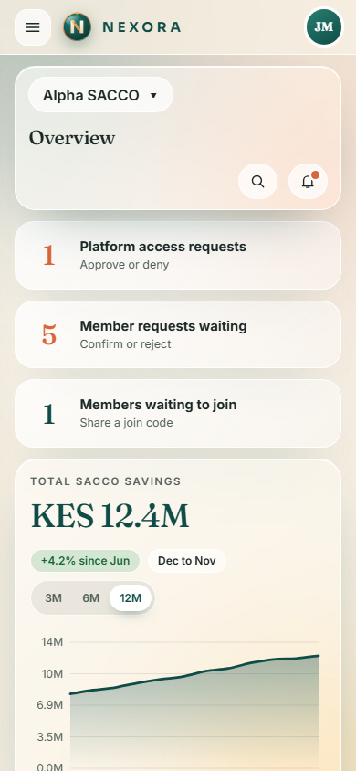 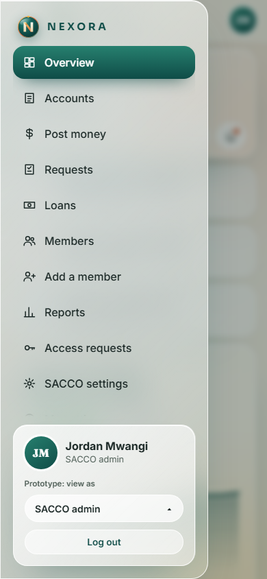

Under 64 rem: the sidebar becomes a **drawer** that slides in from the left over a dim scrim; a slim top bar (`.mbar`) shows the menu button, the coin and the bell. Z-order exactly: `mbar` 60, scrim 65, drawer 70, desktop top bar 50 (this was a real bug before; keep these numbers). Tapping the scrim, pressing Esc, or choosing a menu item closes the drawer. Focus moves into the drawer when it opens and back to the menu button when it closes.

Check at 375, 768, 1280 px. No sideways scroll anywhere.

### R3. Router and placeholder pages

Use `react-router-dom@7` with **hash-free** routes (`/overview`, `/loans`...). Route names are the Routes table in the Common setup. Make `src/shell/pages.js`, one object mapping route name to a lazy import:

```js
export const PAGE_IMPORTS = {
  overview: () => import('../pages/money/overview/OverviewPage.jsx'),
  loans:    () => import('../pages/money/loans/LoansPage.jsx'),
  // ... every route in the table
};
```

If an import fails because the file does not exist yet (Sam's or Neo's page not merged), show a **placeholder**: a `.glass` card with the page title and "This page is being built." Never a blank screen, never a crash. This is what lets you work before anyone else finishes.

`RequireAuth.jsx`: signed out -> redirect to `/login`. Signed in but `guardRoute(perms, path)` returns `'403'` -> render `<ErrorPage code="403" />` inside the shell. Unknown path -> `404` page.

Check: with the role picker (use mock session, R5) as Member, typing `/accounts` shows the 403 page with the sidebar still visible.

### R4. The green wave route change (it takes the theme colour: see R9b step 6)

Pictures:  

Every **route change** inside the app plays the green wave: a teal curtain rises from the bottom (0.9 s), the coin and the pen-written "Nexora" show, the curtain lifts away (1.1 s); total about **1.7 s**. The first-ever load plays the longer intro (**4.8 s**). It must be **smooth**: no stutter, no flash of the new page before the curtain covers it, no abrupt cut.

How: the exact CSS (keyframes, the baked pen-stroke paths, the 2 KB embedded font) is in `docs/frontend/prototype/index.html` and `style.css` (search `curtain`). Port it to `RouteTransition.jsx`: a component that wraps `<Outlet />`, starts the curtain on navigation, swaps the page **while the curtain is fully covering**, then lifts. Use `transform` and `opacity` only (GPU cheap). Respect `prefers-reduced-motion`: then do a quick fade only.

Check: navigate between 5 pages quickly; the curtain never flickers, never stacks twice, and clicking during it does not break anything.

### R5. Session, sign-in, stay signed in, sign out

Build `src/shell/SessionProvider` (in `src/api/session.js` + `App.jsx`) that provides the **same shape** the harness provides: `{ user, role, perms, can, saccoId, sacco, navigate, takeOpen, toast }` through `SessionContext` from `lib/session.jsx`. Then every page works in the real app exactly as in the harness.

- On load: if `getTokens()` has tokens, call `GET /members/me`, then `GET /members/me/saccos`, then permissions (see CONTRACTS section 2) and set the session. If it fails with 401 (after the client's one refresh), go to `/login`.
- `login(email, password)`: `POST /auth/login`, store tokens (`setTokens`), build the session, go to `homeFor(perms)`.
- `logout()`: `POST /auth/logout` (ignore errors), `clearTokens()`, go to `/login`.
- `onSessionEnded(() => ...)` from `lib/http.js`: show the `401` page.
- Permissions: first try `GET /members/me/permissions?sacco_id=`; if it answers 404/405 (Neo has not added it yet) use `ROLES[...]` from `perms.js` keyed by the role in `memberships`. One `if` in `api/session.js`; remove it when Neo's endpoint is merged.
- Mock: `MOCK` true -> sign-in accepts any email with the password `demo`, session built from `mocks/data.js` `me`. Add a **role picker on the login page in mock mode only** so Collins can test every role in the real shell.

Check: sign in, reload the tab -> still signed in. Sign out, reload -> on the sign-in page. Open `/loans` signed out -> sent to sign in, and after signing in you land on `/loans` (remember the target).

### R5b. Account, SACCO code and SACCO PIN: the three entries, and every scenario

Read "How people get in" in the Master file first; this step builds it. Pictures: sign in 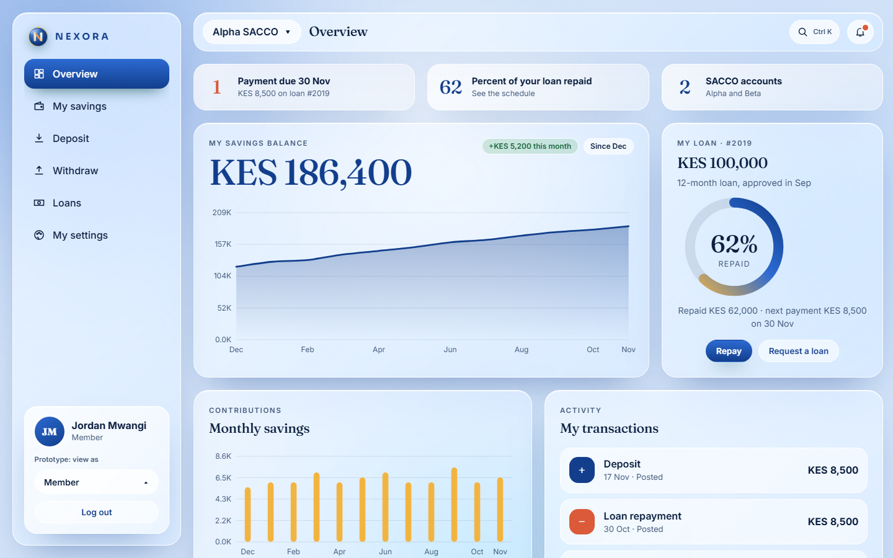 join code 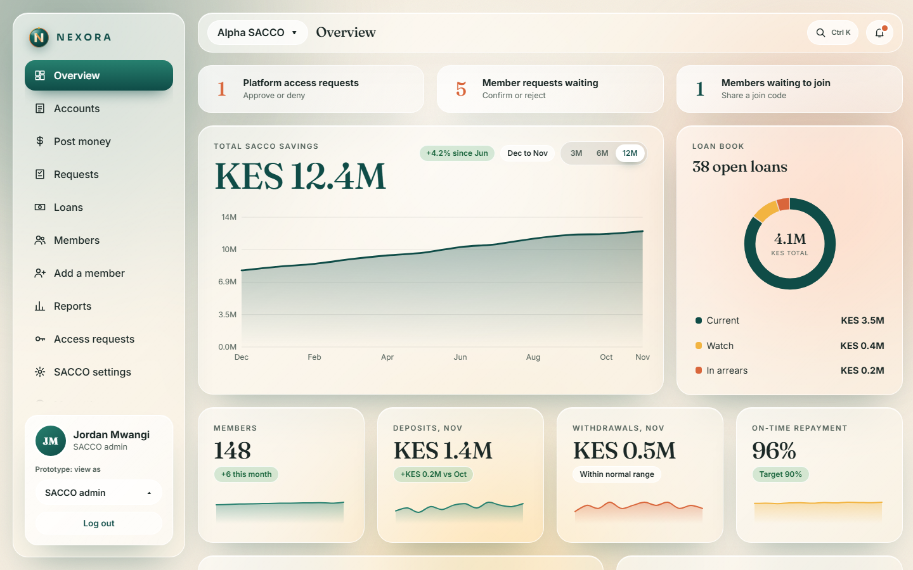 code error  set PIN  switcher 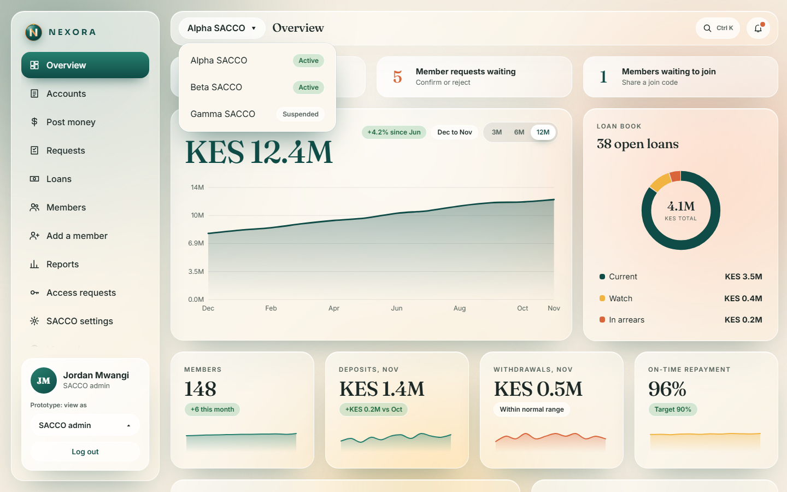

There are **three separate entries** and you build all three. Do not mix them up:

| Entry | Page (route) | Needs | Calls | Result |
|---|---|---|---|---|
| 1. Account | `login`, `register`, `verify`, `forgot`, `reset` | email and password | `/auth/login`, `/auth/register`, `/auth/verify-email`, `/auth/forgot-password`, `/auth/reset-password` | signed in, **in no SACCO yet** |
| 2. Join a SACCO (once) | `join` | being signed in, the phone number the admin used, the 6-digit code | `/auth/join` then `/auth/join/pin` | membership active, the SACCO PIN is set |
| 3. Enter the SACCO (every sign-in, every switch) | `enter` (a full page inside the plain shell) | the 4-digit PIN of that SACCO | `/auth/sacco-login` (also answers at `/auth/sacco-login`) | the SACCO's pages open |

**Steps to build, in this order:**

1. **Sign in** (entry 1). On success store the tokens (`setTokens`) and read `GET /members/me` and `GET /members/me/saccos`. Do **not** open any SACCO page yet. Platform owner (`is_platform_owner`): go straight to `pf-overview`; they have no SACCO PIN.
2. **Decide where to send the person**, in one function `afterSignIn(saccos)` in `src/api/session.js`:
   - 0 active SACCOs: the **"not in a SACCO yet"** page (below).
   - 1 active SACCO: the **Enter your SACCO** page for it.
   - 2 or more: the SACCO chooser (the same list as the switcher, one button per SACCO with its status chip), then Enter your SACCO. A suspended SACCO is listed with the chip "Suspended" and opens the 423 page instead of asking for the PIN.
   - A SACCO where the person is only **invited** (the admin added them but they have not joined): do not list it as enterable; show a card "Join Alpha SACCO: you were invited. Enter your join code." that opens the `join` page.
3. **Join with a code** (entry 2). The page works for a signed-in person. If someone opens `join` while signed out, send them to sign in first and **return them to `join`** afterwards (remember the target, same as for `/loans`). Step 1 form: phone number and 6-digit code (`inputMode="numeric"`, max length 6). Send `POST /auth/join { phone, code }`; on success keep the `setup_token` **in component state only** (never in storage) and show step 2. Step 2 form: PIN and repeat PIN, exactly 4 digits each; check they match before sending; send `POST /auth/join/pin { setup_token, pin }`; on success show a green banner "You are in. Now enter your SACCO." and go to Enter your SACCO for that SACCO. A **Back** button on step 2 is allowed (it is a drill-in), but going back after the code was accepted means the person must enter a **new** code: say so in a small note.
4. **Enter your SACCO** (entry 3). Page layout = the Join PIN card: title "Enter your SACCO", the SACCO's name, four boxes for the PIN (`type="password"`, `inputMode="numeric"`, auto-advance, paste of 4 digits fills all, backspace goes back), **Continue**, and a link "Not your SACCO? Choose another". Send `POST /auth/sacco-login { sacco_id, pin }`. The answer is only `{ok, membership_id, role}`: there is no new token. Keep `enteredSaccoId` in the session provider **in memory** (a React state/ref, not `localStorage`). While `enteredSaccoId` is not the current `saccoId`, `RequireAuth` shows Enter your SACCO instead of any SACCO page. Reloading the tab clears it (the person types the PIN again); signing out clears it; switching SACCO in the switcher asks for that SACCO's PIN. Set `role` and `perms` from the answer and from `GET /members/me/permissions` (or the fallback table).
5. **The "not in a SACCO yet" page.** Plain shell (sidebar shows only My settings), calm centred text like an error page, **no logo, no decoration**: title "You are not in a SACCO yet", sentence "Ask your SACCO admin or a staff member for a join code, then use it here.", buttons **Join with a code** and **Log out**.
6. **Switcher** (`SaccoSwitcher.jsx`): picking another SACCO clears `enteredSaccoId` and opens Enter your SACCO for it (unless that SACCO was already entered in this tab, then switch at once).

**Scenarios and what the code must do (test every row):**

| Scenario | The person sees | Your code |
|---|---|---|
| Wrong email or password | banner "Your email or password is not right." | `describe(err,{context:'login'})`; keep the email typed, clear the password |
| 5 wrong passwords (423) | banner "This account is locked for 15 minutes." and a link to Forgot password | same function; disable the button for the time if `retryAfter` is given |
| Account exists, email not verified | banner with "Send the link again" | `POST /auth/resend-verification`; always show the same sentence ("If that address is registered, a new link is on its way.") |
| Signed in, 0 SACCOs | "You are not in a SACCO yet" page | `saccos.length === 0` |
| Join: code wrong | "That code is not right. Check the 6 digits and try again." under the code field | `CODE_WRONG` |
| Join: code expired (410) | "This code has expired. Ask your admin to add you again for a new one." | `CODE_EXPIRED`; do not clear the phone |
| Join: code used (409) | "This code was already used. Sign in instead, or ask your admin for a new code." | `CODE_USED`; show a link "Enter my SACCO" if the person has a SACCO |
| Join: code burned | "This code is locked after too many wrong tries. Ask your admin to add you again." | server name |
| Join: phone is on another account | "That phone belongs to another account." | 409 sentence |
| Join: already a member | "You are already a member of this SACCO." and a button "Enter my SACCO" | 409 sentence |
| PIN step: took more than 10 minutes | "The setup took too long. Join again with your code." and step 1 returns | 401 from `/auth/join/pin`: drop the `setup_token`, show step 1 |
| PIN step: two PINs differ or not 4 digits | message under the field, nothing sent | frontend check first |
| Enter SACCO: wrong PIN | "That PIN is not right." (and tries left if given) | `PIN_WRONG`; clear the boxes, focus the first |
| Enter SACCO: locked (5 wrong) | "Too many wrong PINs. Try again in 15 minutes, or ask your admin to reset it." and the button disabled | `PIN_LOCKED` 423 with `retryAfter` |
| Enter SACCO: membership deactivated | 403 page | SACCO login answers 403 |
| SACCO suspended (at join, at PIN, or later) | the 423 page "This SACCO is suspended" with "Choose another SACCO" | global 423 handling |
| Person has 2 SACCOs, one suspended | chooser lists both; the suspended one shows the chip and opens the 423 page | status from `GET /members/me/saccos` |
| Reload the tab inside a SACCO | "Enter your SACCO" again | `enteredSaccoId` is memory only |
| Person signs out and a different person signs in on the same computer | nothing of the first person's SACCO is visible | clear session, `enteredSaccoId` and the query cache on logout |

Check, in the real app in mock mode (add a mock for each answer above in `src/mocks/ryan.js`; the mock SACCO PIN is `1234` and the mock join code is `123456`, `000000` is expired, `111111` used, `222222` burned): sign in, reach Enter your SACCO, type a wrong PIN and see the message, type `1234` and reach the Overview; sign in as a mock person with no SACCO and see the "not in a SACCO yet" page; join with `123456`, set a PIN, and land in the SACCO. Take a photo of each row.

### R6. SACCO switcher, top bar, search palette, bell

Pictures:  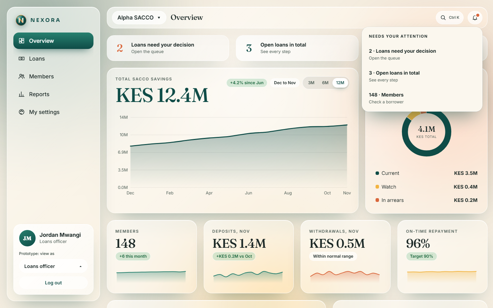 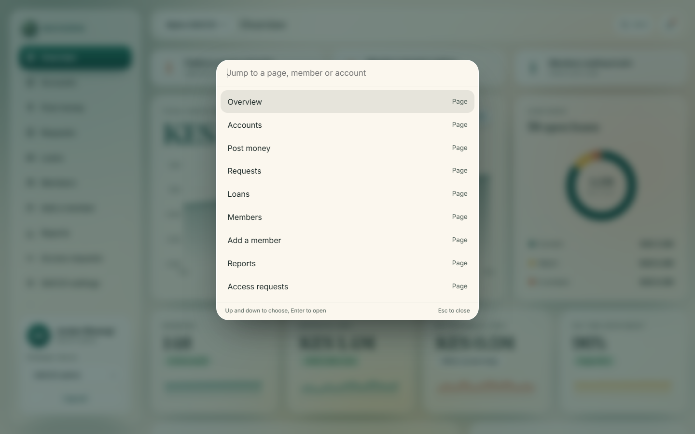

- **Switcher** (`SaccoSwitcher.jsx`): an opaque menu (not see-through) listing the person's SACCOs with a status chip; picking one sets `saccoId`, plays the wave and goes to `overview`. A suspended SACCO shows the 423 page for every page except `account`.
- **Search palette** (`Ctrl+K` or the search button): lists only routes the person may open (`menuFor`), arrow keys and Enter work, Esc closes.
- **Bell**: a dropdown of recent items. In release 1 it shows the SACCO's latest audit entries if the person has `audit.view`, otherwise the empty state "Nothing new."

Check: Ctrl+K, type "loa", Enter opens Loans. Tab order is sensible; focus is trapped in the open menu and returns on close.

### R7. Error wiring (the most important quality item)

Pictures: the Errors section of the Master file. 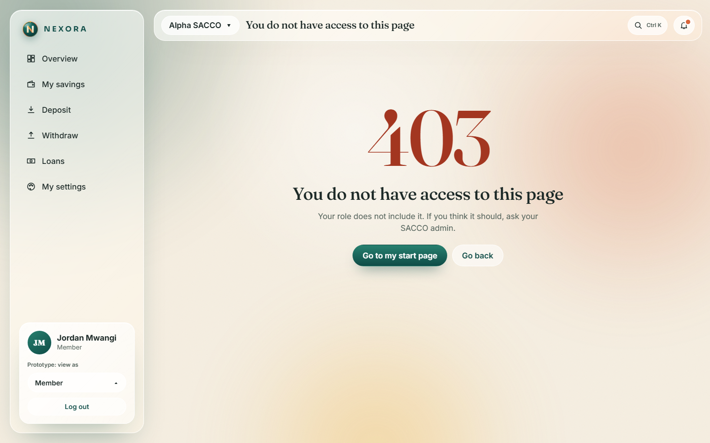 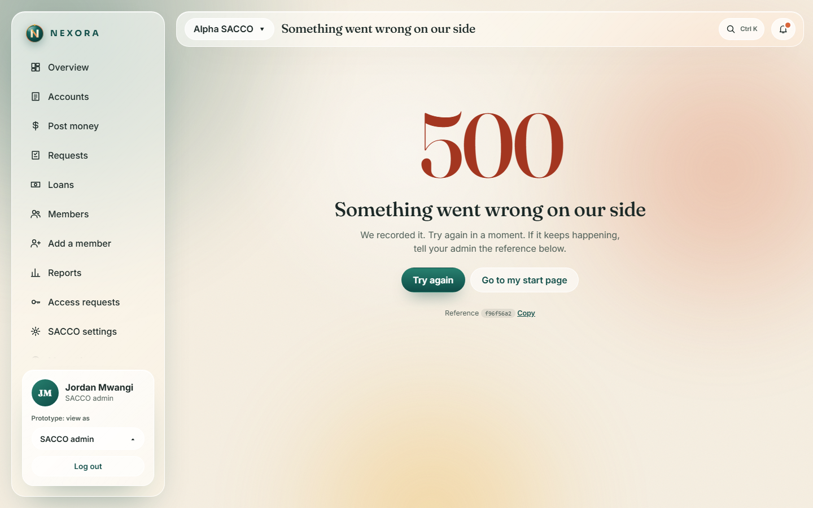

**The error page has no logo and no decoration.** `ErrorPage.jsx` (shared, do not edit) shows only the big code, the title, one sentence and the buttons. Do not wrap it in a card and do not add the coin, an icon or a picture to it anywhere.

1. `PageBoundary.jsx`: an error boundary around the page area (the harness has one to copy) showing `<ErrorPage code="500" />`.
2. `NetBanner.jsx`: when `navigator.onLine` is false or `lib/http.js` reports status 0, show the slim offline banner at the top (picture `error-07-offline.png`); hide it when back.
3. `onAction` handler for `ErrorPage`: `home` -> `navigate('/' + homeFor(perms))`; `back` -> `navigate(-1)` (or home if no history); `login` -> `/login`; `landing` -> `/`; `switcher` -> open the switcher; `account` -> `/account`; `retry` -> re-render the page (change a `key`).
4. A global rule: a page whose `useAsync` fails with `describe(...).page` not null renders `<ErrorPage>`. You supply a small helper `PageState` in `src/shell/` that Sam and Neo **may** use but do not have to (they can use `describe` directly).

Check: with the mock throwing each of 401/403/404/423/429/500/0 on the placeholder page (add a hidden dev switch in the mock session), each full-page error appears with **no logo anywhere on it**, sidebar still there, buttons do the right thing. A Member typing `/accounts` sees the 403 page; the suspended SACCO shows 423 on every page except Account settings; `/nope` shows 404.

### R8. Public pages

Pictures: landing 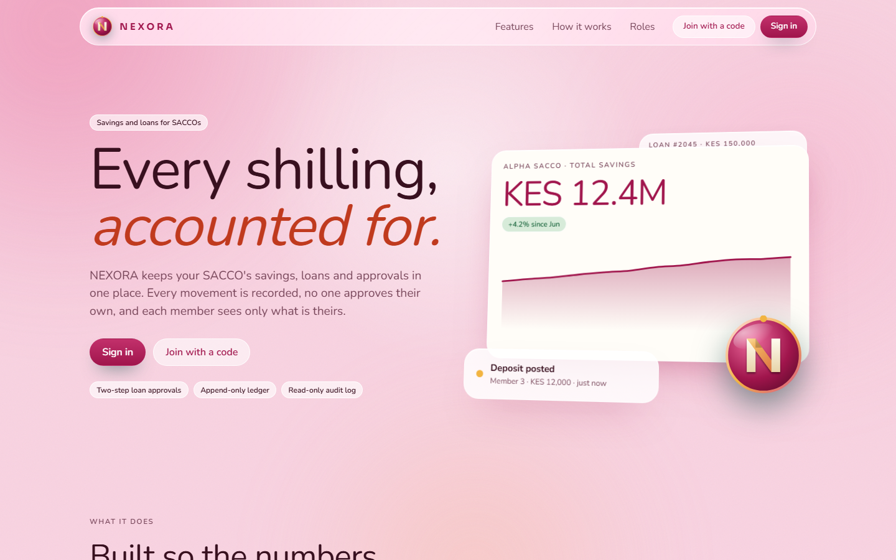 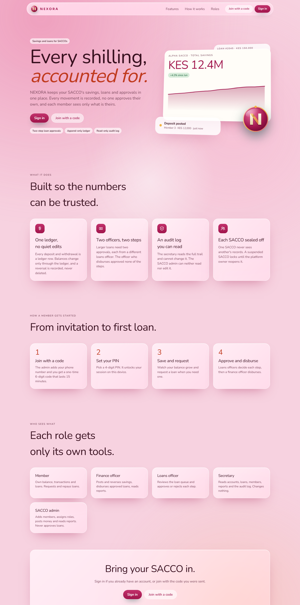 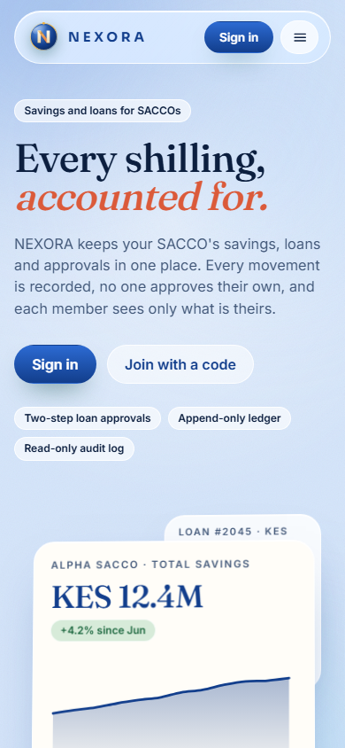; sign in ; join   ; register   ; verify 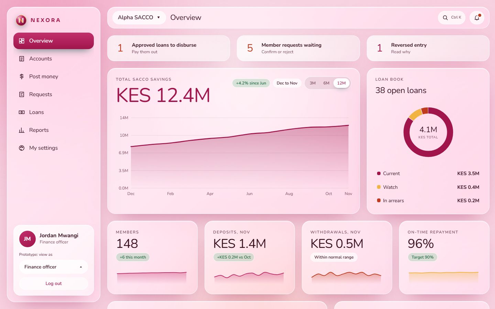; forgot  .

Build each page from its picture and the prototype (`index.html`, `platform.js` for register/verify/forgot, `ext.js` for the landing reveal). Rules: password fields have a show/hide button; every field uses `Field`; submit buttons disable while sending; the Join page tries the code first, then the PIN step; errors use `describe(err, {context:'login'})` for sign-in and the named codes (CODE_WRONG, CODE_EXPIRED, CODE_USED) for join. Landing has the 3D layered hero, scroll reveals, and a menu button instead of nav links on small screens.

Check: submit each form empty (field errors), with a wrong value (banner), and correctly (success). All at 375 px with no sideways scroll.

### R9. Account settings and photo viewer

Pictures: 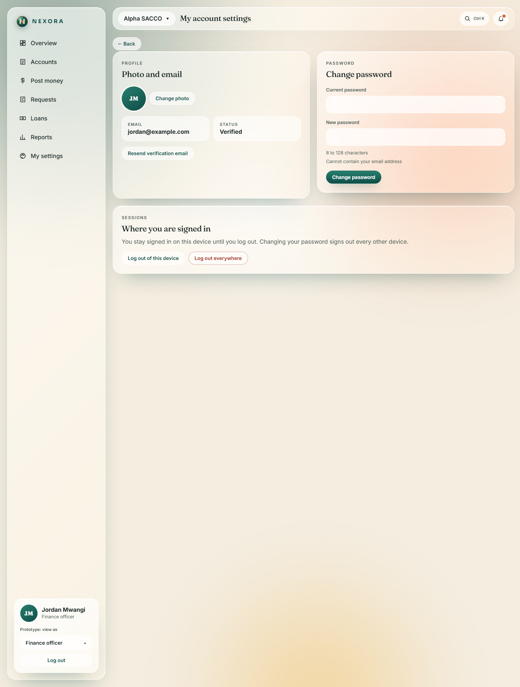 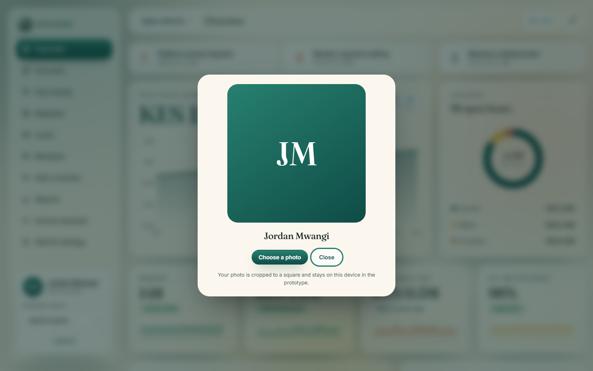

Account settings: profile card (photo, email), change password (`POST /auth/change-password`; on success every session ends, show a green banner and go to sign in), sign out everywhere (`/auth/logout-all`). Photo viewer: clicking the profile photo opens a large view in a dialog (Esc and click outside close it); upload is stored on the device only for now (see Known gaps in the Master file).

### R9b. My settings: colours, font and text size for every user (its own menu item)

Pictures: My settings page 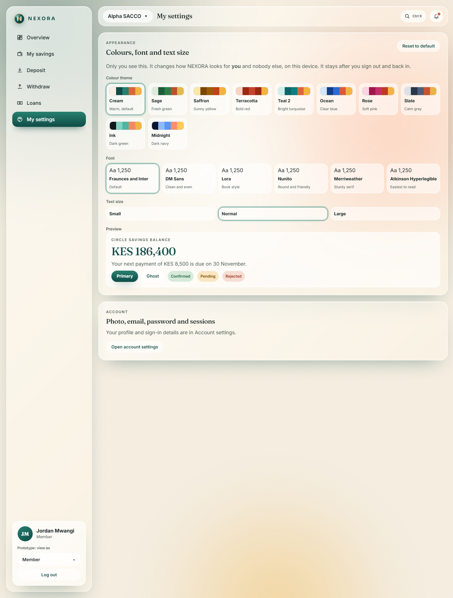 Sage 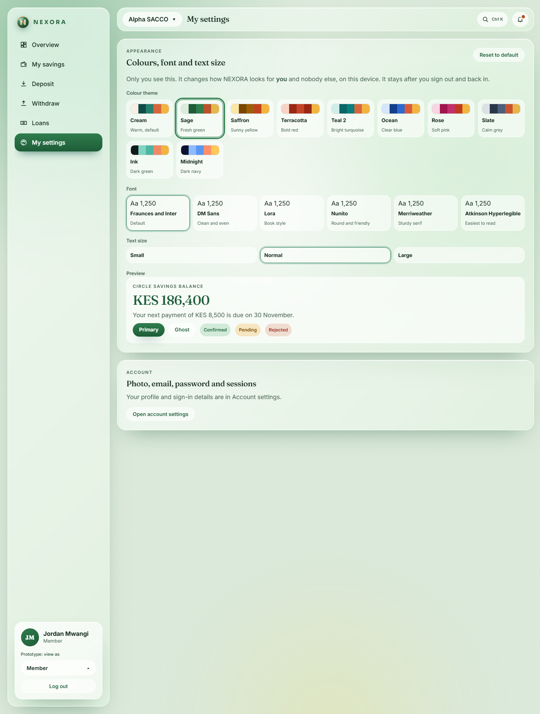 Ink, Lora, Large 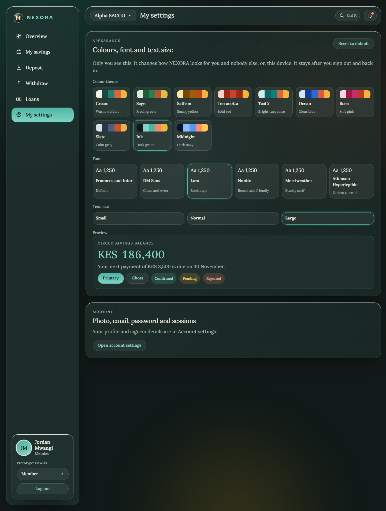 phone 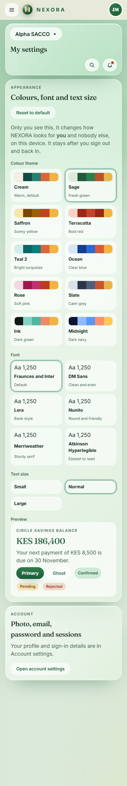

Every person, every role (member, officers, admin, platform owner), can change how NEXORA looks **for themselves**. It has its **own item in the sidebar menu, "My settings", last in the list for every role** (it is not a card at the bottom of Account settings). The page is route `my-settings`. The card and the logic are already in the starter kit, so your job is to wire it in and prove it works, not to design it.

1. In `src/main.jsx` (and you never touch `src/dev/main.jsx`, it already does the same) import the CSS in this order and apply the saved look **before** React renders:

```jsx
import './styles/nexora.css';
import './styles/nexora-2.css';
import './styles/tailwind.css';
import { applyAppearance } from './lib/appearance.js';
applyAppearance();            // sets data-theme, data-font, data-size on <html> from localStorage "nexora.appearance"
```

2. Build `src/pages/account/MySettings.jsx`: a grid with `<AppearanceCard />` (from `components/AppearanceCard.jsx`) full width, then a small card "Account: Photo, email, password and sessions" with a button "Open account settings" that goes to `/account`. It is already in `lib/perms.js` as the route `my-settings` with title "My settings" and `ok: () => true`, so `menuFor(perms)` puts it last in every role's sidebar. Add an icon for it (a SACCO with three dots, like a paint palette) to your icon set and add `my-settings` to `PAGE_IMPORTS` and to your registry file. Account settings keeps the profile, password and sessions cards only.
3. What the card does (so you can test it): **ten colour themes** (Cream default, Sage, Saffron, Terracotta, Teal 2, Ocean, Rose, Slate, and the dark Ink and Midnight), **six fonts** (Fraunces and Inter default, DM Sans, Lora, Nunito, Merriweather, Atkinson Hyperlegible), three text sizes (Small, Normal, Large), a live preview, and **Reset to default**. A choice applies at once with a short smooth colour fade (none when the person asked for reduced motion), is saved under the person's own key `nexora.appearance:<userId>`, and is **not** cleared by signing out.
   **Per person, never shared.** The look belongs to the signed-in person only. (a) In `SessionProvider`, call `syncAppearance(user.id)` whenever the signed-in user changes: right after sign-in, after the session is restored on reload, and `syncAppearance(null)` after sign-out (that shows the default Cream on the public pages). (b) `AppearanceCard` already reads and writes with `user.id`, so you do not pass anything. (c) Switching SACCO does not touch the look. (d) The head script in `index.html` must apply the last person's look before React starts, with the **same key and the same dark list**: `<script>try{var l=localStorage,id=l.getItem('nexora.lastUser'),ap=id?JSON.parse(l.getItem('nexora.appearance:'+id)||'{}'):{},d=document.documentElement;d.dataset.theme=ap.theme||'cream';d.dataset.font=ap.font||'default';d.dataset.size=ap.size||'normal';d.dataset.mode=(ap.theme==='ink'||ap.theme==='midnight')?'dark':'light'}catch(e){}</script>`. Set `nexora.lastUser` to the user id at sign-in and remove it at sign-out. (e) Two tabs: if the same person has two tabs open and changes the look in one, the other follows: call `watchAppearance(() => user.id)` once in `SessionProvider` (it listens to the browser `storage` event). (f) Printing: Reports print black on white in every theme (the print block at the bottom of `nexora-2.css` does it; do not override it). (g) Test: as the Member pick Midnight; sign out; sign in as the SACCO admin: Cream (or the admin's own earlier choice); sign out and back in as the Member: Midnight.
4. Make sure your own shell follows the theme: the sidebar, top bar, drawer, switcher menu, palette, bell and photo viewer must use theme tokens (`bg-cream`, `bg-pop`, `text-ink`, `text-muted`, `border-teal-2`) or the shared classes, never a hex colour. Look at the popup menus in the Ink theme: they must be dark, not cream.
5. The public pages (landing, sign in) also follow the saved look, because `applyAppearance()` runs for the whole app. Check the landing page and sign-in in Ink and Saffron.
6. **The coin and the route-change wave change colour with the theme.** The NEXORA coin (`Logo.jsx`, shared) and the curtain you build in R4 must take their colours from the theme variables, never from hex: the coin disc uses `--disc-a`, `--disc-b`, `--disc-c`, its ring `--ring-a`, `--ring-b`, `--ring-c`; the curtain background is `linear-gradient(165deg, var(--cur-1), var(--cur-2) 55%, var(--cur-3))` with its two curved edges filled `var(--cur-1)` (top) and `var(--cur-3)` (bottom); the glows on the curtain use `color-mix(in srgb, var(--saffron) 22%, transparent)` and the same for `--teal-2` (55%) and `--terra` (32%); the waves on the sign-in page use `--wave-1`, `--wave-2`, `--wave-3`. The values per theme are in the bottom of `nexora-2.css`. What it must look like: Terracotta is **red** (the wave, the curtain and the coin), Sage is **green**, Saffron is **gold**, Teal 2 is **turquoise**, Ocean is **blue**, Rose is **pink**, Slate is **grey**, Ink is **dark green-black** and Midnight is **dark navy** (the cream "Nexora" writing stays clearly visible on all of them). The pen-written "Nexora" animation itself does not change. Pictures: Terracotta  Sage  Saffron  Ink  Ocean  Rose  Slate  Midnight 

Check, in the real app (mock mode), as **each of the six roles** (Member first: the menu must show My settings): open My settings, pick Sage, then Ink, then Midnight, then Nunito, then Large text: the whole page changes, every text stays readable, nothing is cut off at 375 px; reload: the choice is still there; sign out and sign in: still there; press Reset to default: back to Cream, Fraunces and Inter, Normal.
### R10. Add to the harness and hand in

Put your pages in `src/dev/registry.ryan.js` (`account`, and the public pages cannot go in the harness: test those at their own URLs in the real app with `VITE_MOCK=1 npm run dev`). Run the **11-point check** (Common setup, Step 9) on every page and the shell. Take the photos.

## 4. Test as every role (in the real app, mock mode)

Sign in as each of the six roles using the login page's mock role picker. For each: the sidebar matches the table in the Master file exactly (the Member menu is Overview, My savings, Deposit, Withdraw, Loans, My settings; **staff have no My savings, Deposit or Withdraw**; the Finance officer and SACCO admin have Requests; the SACCO admin has Add a member) (compare with the menu pictures), the start page is right (`overview`, or `pf-overview` for the platform owner), a forbidden URL shows the 403 page, switching to the suspended SACCO shows 423.

## 5. Photos to hand in (in `docs/frontend/done/ryan/`)

`shell-desktop-1280.png`, `shell-phone-375.png`, `shell-drawer-375.png`, `shell-tablet-768.png`, `wave-mid-1280.png`, one `menu-<role>.png` for all six roles, `login-1280.png`, `login-error-375.png`, `join-1280.png`, `register-375.png`, `forgot-375.png`, `landing-1280.png`, `landing-375.png`, `error-<code>-1280.png` for all seven errors, `account-1280.png`, `photo-viewer-1280.png`, `appearance-cream-1280.png`, `appearance-sage-1280.png`, `appearance-ink-1280.png`, `appearance-ink-lora-large-375.png`, `wave-terracotta-1280.png`, `wave-sage-1280.png`, `wave-saffron-1280.png`, `wave-ink-1280.png`, and `error-403-member-accounts-1280.png` (no logo).

## 6. Done checklist (paste into your pull request, all ticked)

- [ ] Common setup Steps 0 to 9 done; harness shows my pages
- [ ] Sidebar, top bar, drawer match the pictures at 375, 768, 1280
- [ ] Wave route change smooth; intro plays once; reduced-motion respected
- [ ] Sign in, stay signed in after reload, sign out, return-to-target all work
- [ ] Each of the 6 roles sees exactly its menu; forbidden URL gives 403 inside the shell
- [ ] Suspended SACCO gives 423 for every page except account
- [ ] All seven error pages, offline banner, boundary wired and triggered once; **no logo on any error page**
- [ ] My settings is in the sidebar of every role (last item) with the Appearance card: ten themes, six fonts, three sizes, preview, reset; survives reload and sign-out; shell and public pages follow the theme
- [ ] The look is per person: `syncAppearance(user.id)` on sign-in, restore and sign-out; the Member's Midnight does not appear for the SACCO admin on the same computer
- [ ] Staff menus show no My savings, Deposit or Withdraw; the Overview has no "My account" switch for staff
- [ ] Every theme was tried on the shell, drawer, switcher menu, bell, palette and photo viewer: every word and icon is visible (Lighthouse contrast check in Cream, Saffron, Ink, Midnight)
- [ ] The coin and the wave follow the theme: red in Terracotta, green in Sage, gold in Saffron, blue in Ocean, pink in Rose, grey in Slate, dark in Ink and Midnight; the Nexora writing stays visible
- [ ] All public pages built; forms show field errors and banners
- [ ] R5b: the three entries (account, join with code then PIN, enter your SACCO with PIN), the "not in a SACCO yet" page, the chooser for several SACCOs, and every scenario row tested and photographed
- [ ] Account settings, change password, sign out everywhere
- [ ] 11-point check passed on every page; no `console.error`; no hex colours in className
- [ ] Photos added; only my files committed

## 7. Hand-in

Push `frontend/ryan`, open the pull request into `frontend`, paste this checklist, post "Ryan done" in the team chat. Then answer Collins's list from his review.
