# 02 Neo: backend additions, people pages, platform area

Same format as the files of Ryan, Sam and Collins. First read the Master file once, then do the **Common setup** (Part 1, Steps 0 to 9), **then** do Part 2 (your own work).

## 1. Your goal

Part A: six backend additions that the frontend needs (five small ones, and item 6: **member deposit and withdrawal requests**, so members can deposit and withdraw by M-Pesa or Bank). Part B: the People pages (Members, SACCO settings, Access requests, Audit log). Part C: the Platform area (platform owner only).

Nobody waits for Part A. Ryan has a fallback permission table, Sam filters loans on the client until your changes merge, and Sam builds Deposit, Withdraw and Requests against a mock that has exactly the shapes of item 6 (Master file, section 3b: read it before you start A6). So **Part B and C can be done at any time**, in the harness with sample data, and Part A in parallel.

## 2. Your files (only touch these)

```
backend/app/members/routes.py         (item 1, 2)       backend/app/loans/routes.py   (item 3)
backend/app/cors.py                   (item 4)          backend/app/auth/join_routes.py (item 5)
backend/app/security/permissions.py   (item 6: the permission)
backend/app/models/payment_request.py (item 6: new)     backend/migrations/versions/0025_payment_requests.py (item 6: new)
backend/app/savings/request_validation.py  request_service.py  requests_routes.py   (item 6: new)
tests/                                (one test per item, see below; tests/test_payment_requests.py is new)
docs/roles-permissions.md and the schema doc under docs/   (item 6: add the permission and the table)
src/pages/people/   MembersPage.jsx MemberProfile.jsx AddMemberPage.jsx SettingsPage.jsx AccessPage.jsx AuditPage.jsx
src/pages/platform/ PfOverview.jsx PfSaccos.jsx PfSaccoDetail.jsx PfOwners.jsx PfAccess.jsx PfAudit.jsx
src/api/people.js  src/api/platform.js
src/mocks/neo.js  src/styles/neo.css  src/dev/registry.neo.js
docs/frontend/done/neo/
```

**Do not edit** anything in `src/lib`, `src/components`, `src/mocks/data.js`, `src/styles/nexora*.css`, `src/styles/tailwind.css`, `src/dev/Harness.jsx`, `src/dev/main.jsx`, or any file of Ryan's or Sam's. Bug in a shared file? Tell Collins.

## 3. Part A: the six backend additions (do first, one commit each, each with a test)

Work in the backend on your branch. Run the tests with `pytest` from the repo root before and after each item; all existing tests must still pass.

**A1. `GET /api/v1/members/me/permissions?sacco_id=<id>`** in `backend/app/members/routes.py`. Returns `{"roles": ["finance_officer"], "permissions": ["dashboard.view", ...]}` using `permissions_for(user, sacco)` from `backend/app/security/permissions.py`. For a platform owner with no `sacco_id`, return the platform permissions. 404 if the caller is not a member of that SACCO. Test: a member and an admin get different lists.

**A2. `roles: [...]` on every item of `GET /saccos/<id>/members`** (and on the single-member endpoint). Needs `member.view`, unchanged. Test: the list items contain `roles`.

**A3. `?status=` on `GET /loans/saccos/<id>`.** Accept `requested`, `approved`, `rejected`, `disbursed`, `repaid`; an unknown value gives `400` "Unknown status." Test: filter returns only that status.

**A4. Expose `Retry-After`** in the CORS config in `backend/app/cors.py` (`expose_headers`), so the browser lets the frontend read it on a 429. Test: a 429 response (or the CORS preflight) lists `Retry-After` in `Access-Control-Expose-Headers`.

**A5. Rename `POST /auth/circle-login` to `/auth/sacco-login`**, and keep `/auth/circle-login` answering the same for one release (same function, two routes). Test: both paths work.

**A6. Member deposit and withdrawal requests (the biggest item; do it last, in this order).** Read the Master file, section 3b, first: it is the contract Sam builds against, so the names and shapes there are fixed.

Why: today only an officer can post money (`savings.post`); a member cannot call `POST /savings/accounts/<id>/deposits|withdrawals`. A member needs to ask. A **request** changes no balance. An officer confirms it, and **confirming calls the existing `service.deposit` or `service.withdraw`** in `backend/app/savings/service.py`, so every existing ledger rule (idempotent reference, insufficient funds, tenant check, audit) stays in one place. Do not copy ledger logic.

1. **The permission.** In `backend/app/security/permissions.py` add to `PERMISSIONS`: `"savings.request": "Send a deposit or withdrawal request for my own account"`, and add `"savings.request"` to the `member` set in `ROLE_PERMISSIONS`. Officers do not get it. (`tests/test_access_schema.py` fails if the catalogue and the migration disagree, so step 3 must match.)
2. **The model.** Create `backend/app/models/payment_request.py`: class `PaymentRequest` with the columns in the Master file table (`id, sacco_id, membership_id, kind, method, amount_minor, phone, bank_name, account_ref, reference (unique), status, decided_by, decided_at, reject_reason, ledger_transaction_id, created_at`). Add check constraints: `kind in ('deposit','withdrawal')`, `method in ('mpesa','bank')`, `status in ('pending','confirmed','rejected')`, `amount_minor > 0`. Import the model wherever the other models are imported (search the repo for `from app.models.loan import`) so `create_all` in the tests creates the table.
3. **The migration.** Create `backend/migrations/versions/0025_payment_requests.py` with `revision = "0025"` and `down_revision = "0024"` (copy the layout of `0022_sacco_update_admin_manage.py`). `upgrade()` creates the table with its indexes on `sacco_id` and `membership_id` and the unique constraint on `reference`, inserts the permission into `permissions`, and inserts the `role_permissions` row for the role `member` (same `INSERT ... ON CONFLICT DO NOTHING` pattern as 0022). `downgrade()` deletes the role_permissions and permissions rows and drops the table.
4. **Validation.** Create `backend/app/savings/request_validation.py` with `parse_request(body)` returning a clean object or raising `InvalidRequest` (the class `routes.py` already turns into a `400`): `kind` and `method` must be allowed values; `amount` an integer greater than 0 (minor units); `reference` a non-empty string of at most 64 characters; for `mpesa` the `phone` must normalise to `254` followed by `7` or `1` and 8 digits (accept `07..`, `01..`, `+254..`, `254..`, with spaces or dashes; message: `Enter a Safaricom number like 0712 345 678.`); for `bank` `bank_name` (2 to 60 characters) and `account_ref` (3 to 40 characters) are required.
5. **The service.** Create `backend/app/savings/request_service.py`:
   - `create(user_id, sacco_id, data)`: the caller must hold `savings.request` in that SACCO (use `can(...)` exactly as `service.py` does) and have an active membership; a SACCO that is not active answers 423 like the other routes. If a row with the same `reference` already exists for this membership return it with `replayed=True` (the route answers `200`); if the same reference belongs to someone else or to different details answer `409 DUPLICATE_REFERENCE`. For a withdrawal, read the member's balance with the same helper `GET /savings/accounts/me` uses and answer `409 INSUFFICIENT_FUNDS` when `amount_minor` is more than the balance. Insert with `status = 'pending'`.
   - `list_mine(user_id, sacco_id, kind, limit, cursor)` and `list_for_sacco(user_id, sacco_id, status, limit, cursor)` (needs `savings.post`; include the requester's `email`). Newest first.
   - `confirm(user_id, request_id, reference)`: load the row `FOR UPDATE` (one transaction); needs `savings.post` in the row's SACCO; **an officer cannot decide their own request** (the request's membership belongs to `user_id`): answer `403 OWN_REQUEST`; if not `pending` answer `409 REQUEST_ALREADY_DECIDED`; find the member's savings account; call `service.deposit(user_id, account_id, amount_minor, reference)` or `service.withdraw(...)`; store `ledger_transaction_id`, set `status = 'confirmed'`, `decided_by`, `decided_at`; write the audit entry the same way the other officer actions do (`action = 'savings.request.confirm'`). If `service.withdraw` raises `INSUFFICIENT_FUNDS`, let it pass through as `409` and leave the request `pending`.
   - `reject(user_id, request_id, reason)`: needs `savings.post`; reason required (`400` `Write a reason before you reject this request.`); not own; not already decided; set `rejected`, `reject_reason`, `decided_by`, `decided_at`; audit `savings.request.reject`.
6. **The routes.** Create `backend/app/savings/requests_routes.py` on `savings_bp` (import it from the same place `routes.py` is imported so Flask registers it). Use the same decorators as the money routes: `@money_limit` (or `@write_limit` for reject and the lists) and `@signed_in`. Paths: `POST /savings/requests`, `GET /savings/requests/me`, `GET /savings/saccos/<int:sacco_id>/requests`, `POST /savings/requests/<int:request_id>/confirm`, `POST /savings/requests/<int:request_id>/reject`. Status codes: `201` new, `200` replay, errors through `error_response(status, message, code=...)`. Return `amount_minor` and the item shape in the Master file.
7. **The tests.** Create `tests/test_payment_requests.py` using the helpers in `tests/savings_support.py` (they make a SACCO, members with roles and an account). One test each: (a) a member creates a deposit request by M-Pesa and by Bank and gets `201`; (b) the same `reference` twice returns `200` and the same id, and only one row exists; (c) a bad phone gives `400` with the sentence; (d) a withdrawal above the balance gives `409 INSUFFICIENT_FUNDS`; (e) a finance officer calling `POST /savings/requests` gets `403` (no `savings.request`); (f) a member cannot list the SACCO queue (`403`); (g) the officer lists pending requests; (h) confirming a deposit raises the member's balance by exactly the amount and links `ledger_transaction_id`; (i) confirming twice gives `409 REQUEST_ALREADY_DECIDED` and the balance changes once; (j) an officer who is also the requester gets `403 OWN_REQUEST`; (k) rejecting without a reason gives `400`, with a reason sets `rejected` and the balance is unchanged; (l) a member of another SACCO cannot see or decide the request (`403` or `404`, like the other tenant tests); (m) a suspended SACCO answers `423`; (n) `test_access_schema.py` still passes (catalogue and migration agree).
8. **The docs.** Add the `savings.request` row to `docs/roles-permissions.md` (member column) and the `payment_requests` table to the schema document under `docs/` (the one that describes the other tables), with the same column list as the Master file.

Check A6: `pytest` is green; run the migration on a fresh database (`flask db upgrade`), downgrade one step and upgrade again without error; with the member's token `POST /savings/requests` returns `201`; with the finance officer's token `POST /savings/requests/<id>/confirm` returns `200` and the member's `GET /savings/accounts/me` balance is higher by the amount.

Check: `pytest` is green. Post "A1-A6 done" in the team chat with the commit list.

## 4. Part B: the People pages

### N1. Members list and member profile (menu item "Members")

Pictures: 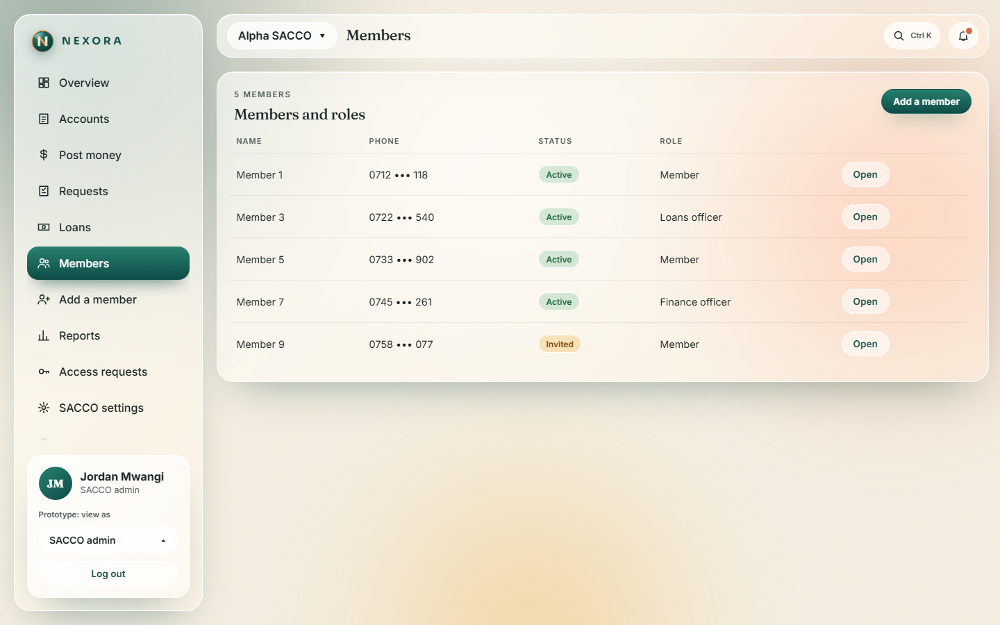 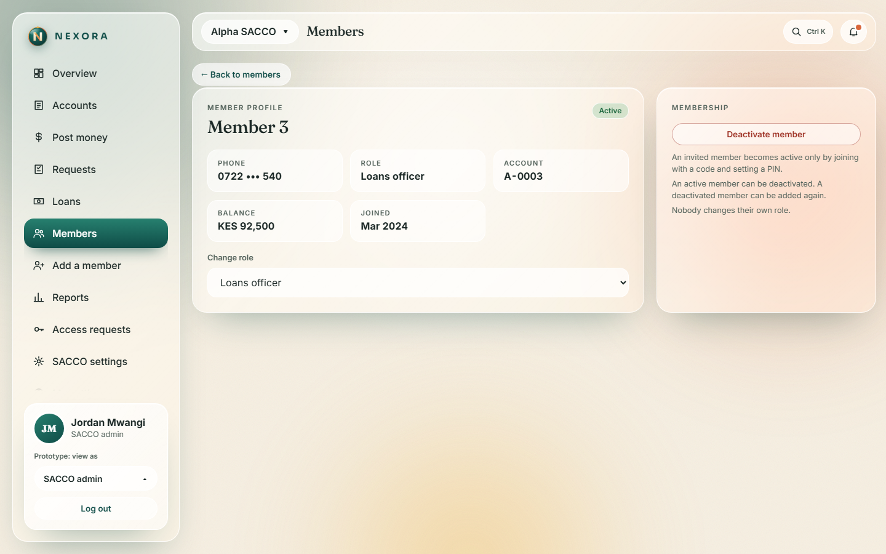 staff view without the Add button 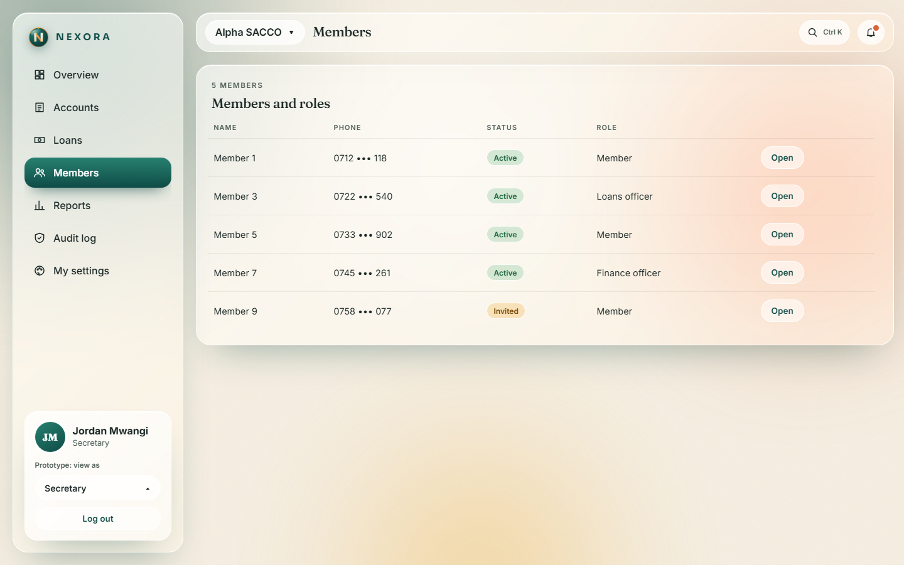

`MembersPage`: searchable list (`GET /saccos/<id>/members`), full width. Each row shows the **email** (the API has no names) with the initials circle from the first letter of the email, a role chip per role, a status chip, and opens `MemberProfile` (**Back to members**, because it is a drill-in). In the header of the list card, the SACCO admin (`can('member.manage')`) sees a button **Add a member** that goes to the Add a member page (N1b). Nobody else sees it. **The Add form is not on this page any more: adding a member is a section of its own.**

`MemberProfile`: details, roles (checkboxes; `PUT .../roles`, needs `member.manage`), status change (`PATCH`, asks to confirm), and for a member who is still **Invited** the button **Send a new code** (it goes to the same call as N1b and shows the new code in a card on the profile). Errors from the named codes show as banners.

Mock: `mocks/neo.js` with 8 members of mixed roles. Harness roles that see the list: loans officer, secretary, SACCO admin (`member.view`). Only the SACCO admin sees the manage buttons and the Add a member item (`member.manage`).

### N1b. Add a member: a section of its own (menu item "Add a member", route `add-member`, SACCO admin)

Pictures: the page 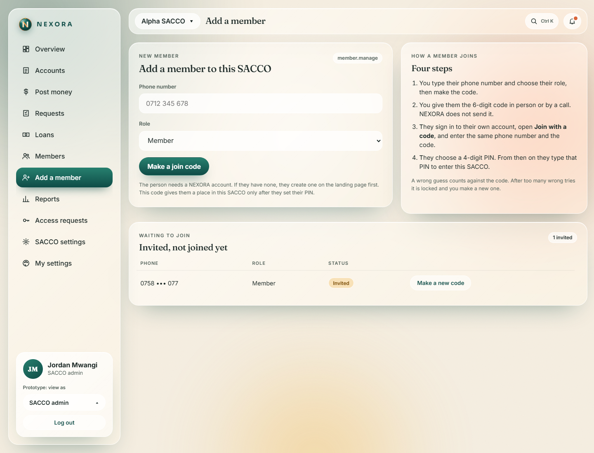 a code made 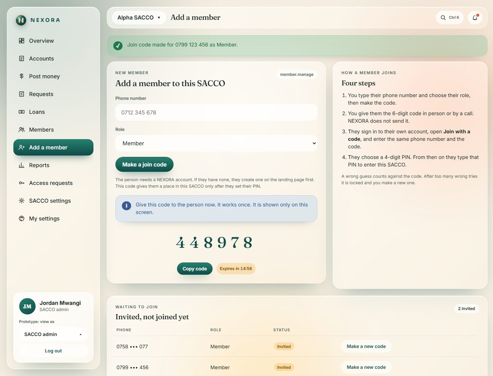 a wrong phone 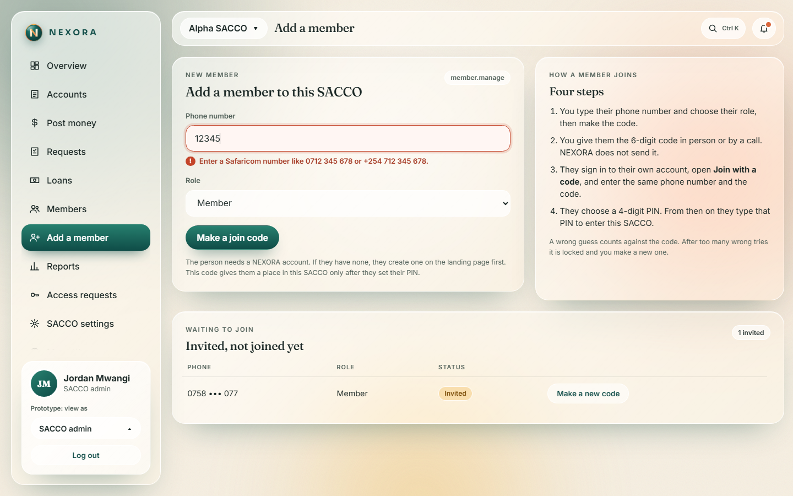

Why it is its own page: members are added all the time and the admin must find it at once, not hunt for a small card. It sits right after **Members** in the admin's menu. Permission `member.manage`. It is a menu page, so **no Back button**. Files: `src/pages/people/AddMemberPage.jsx`, `src/api/people.js` (`addMember`, `listInvited`).

**Layout** (12-column grid, one column on a phone):
1. Left card, 7 columns: title **Add a member to this SACCO**, a field **Phone number** (`inputMode="tel"`, placeholder `0712 345 678`), a field **Role** (a select: Member, Secretary, Finance officer, Loans officer; the SACCO admin role is not offered here, only a platform owner makes an admin, see 4b), the button **Make a join code**, and the note "The person needs a NEXORA account. If they have none, they create one on the landing page first. This code gives them a place in this SACCO only after they set their PIN."
2. Right card, 5 columns: **How a member joins**, four numbered steps (you type the phone and role and make the code; you give them the code in person or by a call, NEXORA does not send it; they sign in to their own account, open Join with a code and enter the same phone and the code; they choose a 4-digit PIN and from then on type it to enter this SACCO) and the note that wrong guesses burn the code.
3. Full-width card under them: **Invited, not joined yet**, a table (Phone, Role, Status chip Invited, button **Make a new code**) with a count chip "N invited". Empty text: "Nobody is waiting. People you add appear here until they join."

**What happens, step by step:**
1. The admin types the phone and picks a role. Validate before sending: the phone must be a Kenyan mobile (`/^(?:\+254|254|0)([17]\d{8})$/` after removing spaces and dashes); otherwise the message under the field is `Enter a Safaricom number like 0712 345 678 or +254 712 345 678.` and nothing is sent.
2. Send `addMember(saccoId, { phone, role })` = `POST /saccos/<id>/members { phone, role }`. Disable the button while sending. The answer holds the 6-digit join code and when it ends (15 minutes).
3. Show a green banner "Join code made for 0799 123 456 as Member." and, inside the left card, an info banner "Give this code to the person now. It works once. It is shown only on this screen.", the code in big type (the prototype's `code-box`), a **Copy code** button (clipboard; if the clipboard is blocked, select the text and say "Select the code and copy it."), and a chip with a live countdown `Expires in 14:52`. When it reaches zero replace it with a red banner "That code expired. Make a new one."
4. The new person appears in the table under "Invited, not joined yet".
5. **Make a new code** on a row calls the same endpoint for that phone and role: a fresh code replaces the old one, which stops working. Banner: "A new code was made for 0799 123 456. The old one stopped working."
6. The code is **never stored** in the page's storage or logged. Leaving the page and coming back does not show it again (the admin makes a new one).

**Scenarios:**

| Scenario | What the admin sees | What the code does |
|---|---|---|
| Phone is not a Kenyan mobile | message under Phone, nothing sent | frontend check, then the server's 400 sentence if it still answers one |
| The number is already an active member | message under Phone: "This number is already a member." | 409 sentence |
| The number was already invited and has not joined | info banner "This number was already invited. A new code was made and the old one stopped working." and the new code | same call; the role is replaced by the one chosen |
| The admin leaves the page with a code showing | the code is gone when they return; the person is still in the invited table | the code is state in the component only |
| The member does not join within 15 minutes | the code expires; the row stays Invited | admin presses Make a new code |
| The circle is suspended | the 423 page | global 423 handling |
| A role without `member.manage` opens `/add-member` | the 403 page (no menu item either) | `guardRoute` |
| The network drops after pressing Make a join code | banner "We could not confirm that went through. Press Make a join code again; a new code is made and the old one stops working." | no money is involved, so a repeat just makes a new code |

Check, in the harness as SACCO admin: the page is in the menu after Members; wrong phone shows the message; a good phone makes a code with a running countdown; Copy works; the person shows under Invited; Make a new code changes the code; as Secretary and Loans officer the menu item is missing and `/add-member` shows the 403 page.
### N2. SACCO settings

Picture: 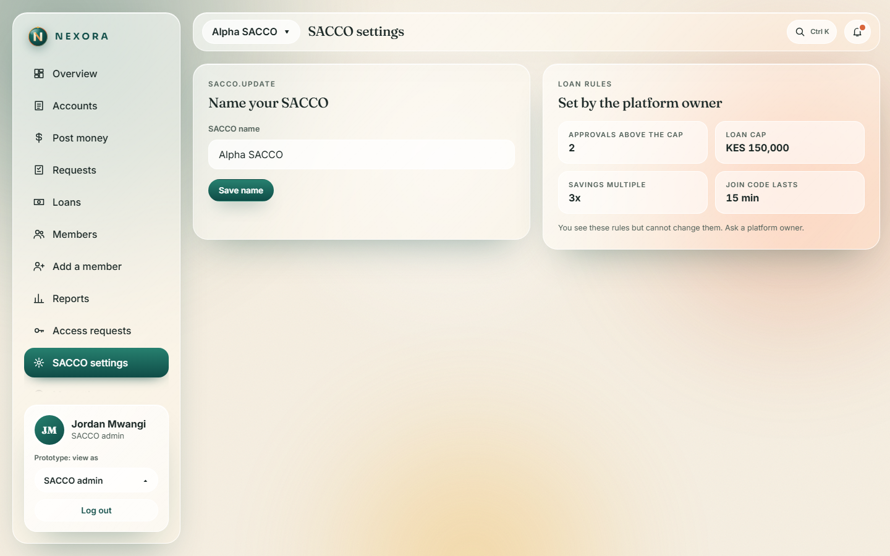

Form for the SACCO's settings (`GET` and `PATCH /saccos/<id>/settings`, name via `PATCH /saccos/<id>`). Needs `sacco.update`. Show a green banner on save; field errors under inputs; 423 shows the suspended page.

### N3. Access requests

Picture: 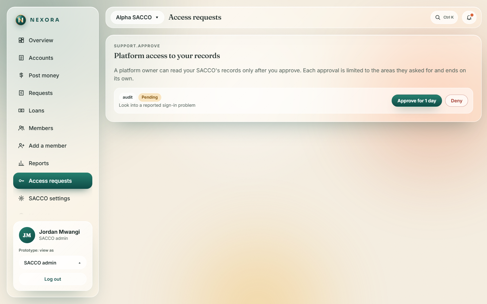

List of platform support-access requests for this SACCO (`GET /saccos/<id>/support-access`) with status chips. For pending ones: **Approve** (with how long, in hours, default per the API) and **Deny**; for approved ones: **Revoke** (only the SACCO admin may revoke). Needs `support.approve`. After a decision the row updates without a page reload. Confirm dialogs for Deny and Revoke.

### N4. Audit log

Picture: 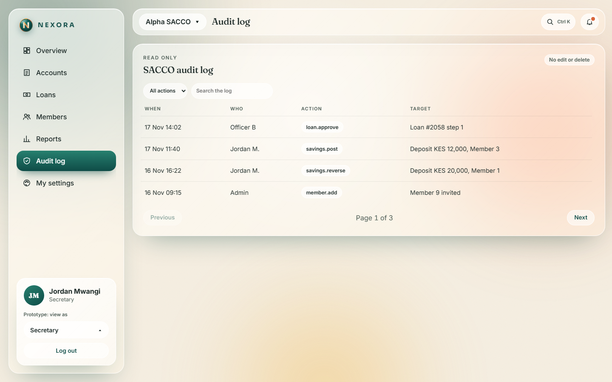

Read-only timeline (`GET /admin/saccos/<id>/audit`) with filter chips and Load more; needs `audit.view` (Secretary). Each entry: what happened, who, when. Empty state "No activity yet."

## 4b. How circles and join codes work, with every scenario (read before N1 and Part C)

Read "How people get in" in the Master file. You own the two places where it starts: **creating a circle** (Platform area) and **issuing a join code** (Members page). Pictures: 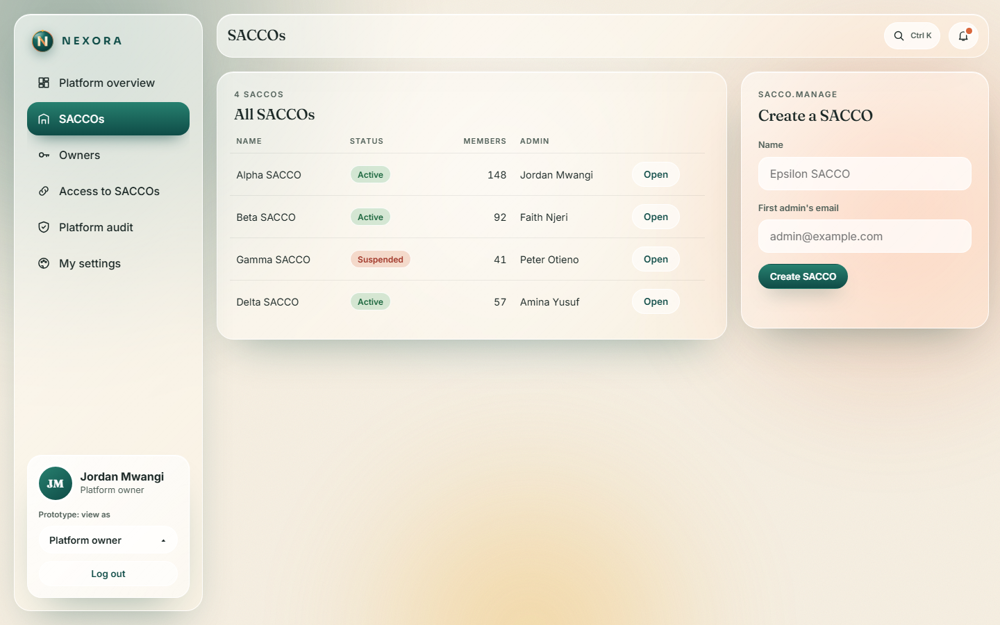 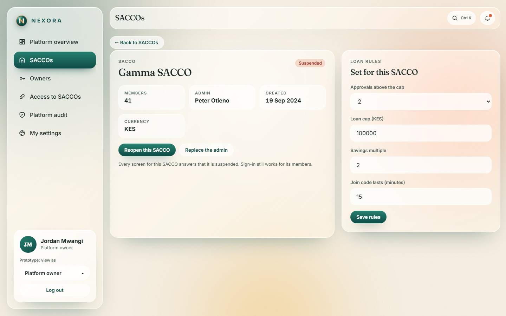  

**Creating a circle (platform owner, `pf-saccos`).** Note on the picture: the prototype's Create SACCO form shows **Name** and **First admin's email**. The real API takes a name and a currency (`POST /saccos`) and has no admin field, so build the form with **Name** and **Currency** (KES by default) and put the first admin in the second step below, by phone number and join code. The email box in the picture is replaced by that second step. The "Create SACCO" form has a **name** and a **currency** (a short list: KES default). Send `POST /saccos {name, currency}`. A new circle appears in the list with the chip **Active** and **0 members**. It cannot be used until it has an admin: after creating, show a card "Next: add the first SACCO admin" (name of the person's phone number, role SACCO admin) that opens the same add-member form with the role fixed to SACCO admin (`POST /saccos/<id>/members {phone, role:'circle_admin'}`; only a platform owner holds `admin.manage`, so the role list shows SACCO admin only to the platform owner). The platform owner then gives that admin the join code in person.

| Scenario | What the person sees | What the code does |
|---|---|---|
| Name empty or only spaces | message under Name: "Give the SACCO a name." | frontend check, then the server 400 sentence |
| Name already used | message under Name with the server sentence | 409 sentence shown as it is |
| Currency not in the list | cannot happen (a select), but a 400 shows as a banner | server sentence |
| Created | green banner "Alpha SACCO was created." and the row appears at the top with 0 members | refresh the list; offer "Add the first admin" |
| Deactivate a circle | a confirm: "This locks the SACCO's records for all its members." then the chip becomes Suspended | `POST /saccos/<id>/deactivate`; members now see the 423 page everywhere except Account settings and My settings |
| Activate again | chip Active; members get in again with their existing PINs | `POST /saccos/<id>/activate` |
| The platform owner tries to read money | there is no button, no link, no number | never call accounts, ledger or loans from `pf-*` pages |

**Issuing a join code (the Add a member page, route `add-member`, needs `member.manage`; see N1b for the page).** Form: phone number. The number is normalised by the server (accept `0712 345 678`, `+254 712 345 678`). Send `POST /saccos/<id>/members {phone, role}`. The answer holds the join code. Show it **once**, big, with Copy and a visible 15-minute countdown (the prototype's `code-box`). Closing the card hides the code for good: say so under it ("This code is shown only now.").

| Scenario | What the admin sees | What the code does |
|---|---|---|
| Phone already invited, not yet joined | "This number was already invited. A new code was made and the old one stopped working." and the new code | re-invite is a new code; show the same card |
| Phone already an active member | message under Phone: "This number is already a member." | 409 sentence |
| Phone not valid | message under Phone: "Enter a Safaricom number like 0712 345 678." | frontend check, then 400 |
| The member says the code does not work | the admin opens the member's profile and presses **Send a new code** | same call as re-invite; the member row shows "Invited" until they join |
| The member forgot their circle PIN | the admin presses **Re-add with a new code** on the profile; the member joins again and sets a new PIN | same call; PIN is replaced when the join completes |
| The admin deactivates a member | the row shows Inactive; that person's next Enter-your-circle attempt shows the 403 page | `PATCH` status; ask for confirmation first |
| The admin changes a member's role | the member's menu changes on their next page change | `PUT .../roles` (needs `member.manage`); a person cannot change their own role (server says so; show the sentence) |
| Not allowed to add members (secretary, loans officer, finance officer, member) | there is no Add a member menu item and no button on Members | `can('member.manage')` hides both; typing `/add-member` gives the 403 page; the API call gets 403 |

Who may issue codes today: only the SACCO admin (`member.manage`). If the team gives it to another role, you add the permission in `backend/app/security/permissions.py` and a migration; the page already follows `can('member.manage')`.

## 5. Part C: the Platform area (platform owner only)

Pictures: 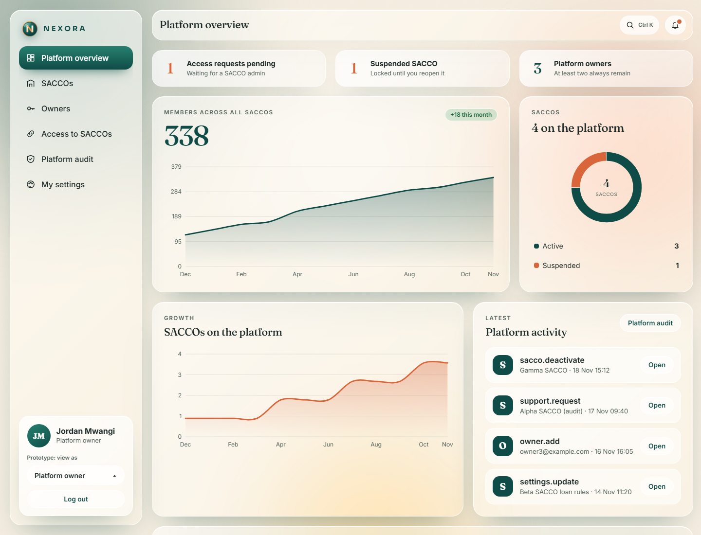   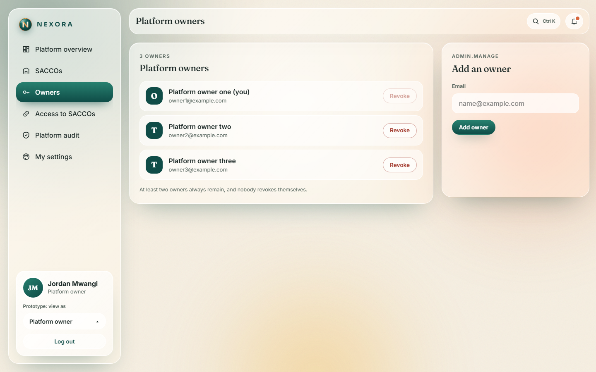 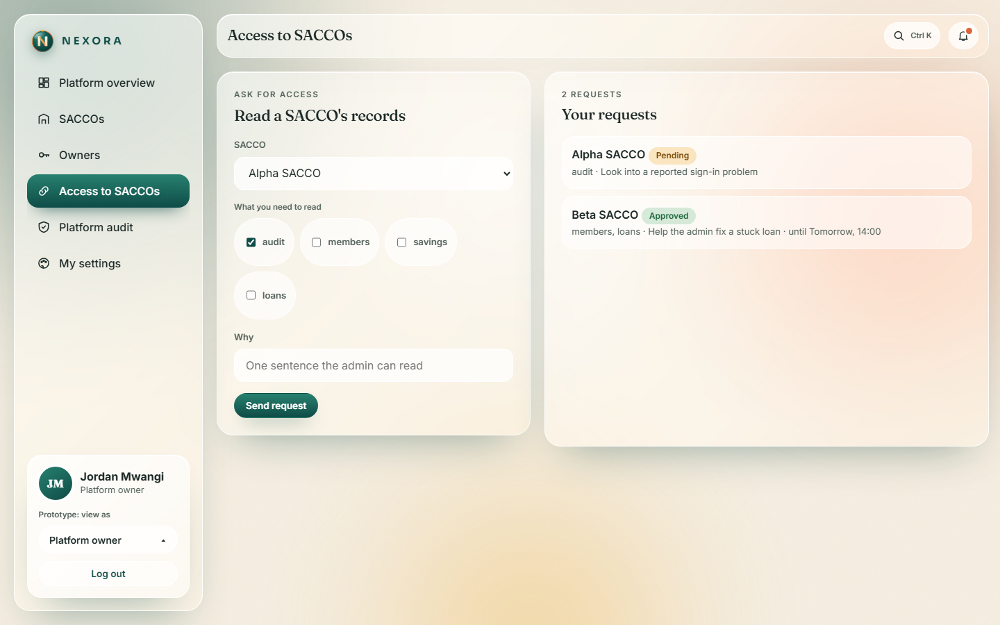 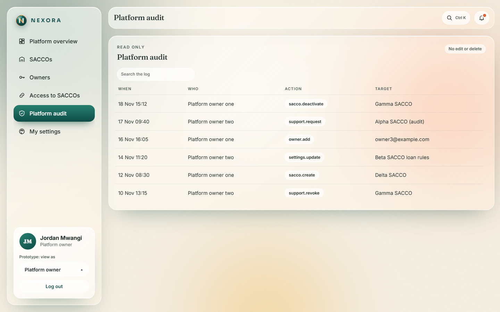

The platform owner **cannot read SACCO money**: these pages show counts and statuses only. Never fetch accounts, ledger or loans.

- `pf-overview`: number of SACCOs (active/suspended), members, recent platform activity. **Every row is clickable**: a "SACCO deactivated" row opens that SACCO's detail.
- `pf-saccos`: list (`GET /saccos`), **Create SACCO** form (`POST /saccos` with `name`, `currency`); a row opens `pf-saccos` detail (**Back to SACCOs**) with **Deactivate** or **Activate** (`POST /saccos/<id>/deactivate|activate`, confirm dialog: "This locks the SACCO's records for all its members.").
- `pf-owners`: list of platform owners, add (`POST /admin/owners`) and remove (`DELETE /admin/owners/<user_id>`, you cannot remove yourself: show the server sentence).
- `pf-access`: ask a SACCO for support access (`POST /saccos/<id>/support-access` with `reason` and `scope`), and see the status of each request; there is **no Revoke button** for the owner.
- `pf-audit`: `GET /admin/audit`, same look as the SACCO audit log.

Part C is the stretch goal. If time runs out, finish `pf-overview` and `pf-saccos` and record the rest in "Known gaps" in your pull request.

## 6. Add to the harness, test, hand in

Register your pages in `src/dev/registry.neo.js`: `members`, `add-member`, `settings`, `access`, `audit`, `pf-overview`, `pf-saccos`, `pf-owners`, `pf-access`, `pf-audit`. Run the **11-point check** for each page for each role that may open it. Take the photos. Open the pull request (backend commits and frontend commits in the same PR is fine).

## 7. Test as every role

| Role | Must see | Must NOT see |
|---|---|---|
| Member | none of your pages; with the real backend, `POST /savings/requests` works, the officer calls do not (403) | typing `/members` gives 403 |
| Loans officer | Members (read-only) | Add a member, role boxes, settings, access, audit |
| Finance officer | none of your pages; with the real backend, can list and confirm requests, cannot create one | 403 on all your pages |
| Secretary | Members (read-only), Audit log | settings, access, manage buttons |
| SACCO admin | Members with manage, **Add a member (its own page)**, SACCO settings, Access requests (with Revoke) | audit (not in its permission list), platform pages |
| Platform owner | all five platform pages | any SACCO page; no balances anywhere; no Revoke |

## 8. Photos to hand in (in `docs/frontend/done/neo/`)

`members`, `member-profile`, `add-member` (empty, code made, error), `settings`, `access`, `audit`, each `-ready-1280.png` and `-ready-375.png`; the five platform pages `-ready-1280.png` and `-ready-375.png`; for `members` and `access` also `-loading`, `-empty`, `-error`; `confirm-deactivate-1280.png`. Backend: paste the `pytest` summary line in the pull request.

## 9. Done checklist (paste into your pull request, all ticked)

- [ ] Common setup Steps 0 to 9 done; harness shows my pages
- [ ] A1 to A6 each have a commit and a passing test; the whole `pytest` run is green
- [ ] A6: `savings.request` permission, migration 0025 up and down, five endpoints, all 14 tests (a to n), docs updated; a confirm posts exactly one ledger entry and a second confirm does not
- [ ] Members list (full width, with the Add a member button for the admin), profile, roles, status
- [ ] **Add a member as its own page**: phone and role, join code shown once with a 15-minute countdown and Copy, Invited table with Make a new code, every scenario row handled
- [ ] Section 4b: circle creation with "add the first admin", every scenario row handled and photographed
- [ ] SACCO settings, Access requests (approve, deny, revoke by admin only), Audit log
- [ ] Platform: overview with clickable rows, SACCOs with create/activate/deactivate and confirm, owners, access (no revoke), audit
- [ ] Platform pages never request or show balances
- [ ] Every page has loading, empty, error (with Try again) and ready states
- [ ] 11-point check passed for every role on every page; no bare px sizes; no hex colours in className; no `role ===`; no `fetch(`
- [ ] Photos added; only my files committed
- [ ] Anything not finished is listed under Known gaps in the pull request

## 10. Hand-in

Push `frontend/neo`, open the pull request into `frontend`, paste this checklist, post "Neo done" in the team chat. Then answer Collins's list.
