# 03 Sam: money and loans

Same format as the files of Ryan, Neo and Collins. First read the Master file once, then do the **Common setup** (Part 1, Steps 0 to 9), **then** do Part 2 (your own work).

## 1. Your goal

Build every screen that shows or moves money: Overview (the SACCO's version for staff, the member's own version for members, with charts), My savings (members only), **Deposit and Withdraw (members choose M-Pesa or Bank)**, Accounts and the ledger, Post money (officers post a deposit, withdrawal, reverse), **Requests (officers confirm or reject the members' requests)**, Loans (list, detail, request, decide, disburse, repay) and Reports.

You do **not** depend on Ryan's shell or Neo's backend. You build and test in the **dev harness** with sample data and the role picker. Your pages read everything from `useSession()`, so they drop into Ryan's real shell with no change.

## 2. Your files (only touch these)

```
src/pages/money/
  overview/   OverviewPage.jsx  SaccoOverview.jsx  MemberOverview.jsx
  savings/    SavingsPage.jsx
  requests/   DepositPage.jsx  WithdrawPage.jsx  RequestsPage.jsx  MethodSwitch.jsx  RequestHistory.jsx
  accounts/   AccountsPage.jsx  LedgerPage.jsx
  post/       PostMoneyPage.jsx
  loans/      LoansPage.jsx  LoanDetail.jsx  LoanRequest.jsx
  reports/    ReportsPage.jsx
src/api/money.js  src/api/loans.js  src/api/reports.js  src/api/requests.js
src/mocks/sam.js  src/styles/sam.css  src/dev/registry.sam.js
docs/frontend/done/sam/
```

**Do not edit:** `src/lib`, `src/components`, `src/mocks/data.js`, `src/styles/nexora*.css`, `src/styles/tailwind.css`, `src/dev/Harness.jsx`, `src/dev/main.jsx`, and anything of Ryan's or Neo's. Bug in a shared file? Tell Collins.

Your registry file lists every page you build: `overview`, `savings`, `deposit`, `withdraw`, `accounts`, `money`, `requests`, `loans`, `reports`.

## 3. Rules that matter most for money

1. **Minor units** everywhere on the wire: show with `kesFromMinor(n)`, send with `toMinor(shillings)`. Never use floating point arithmetic on money; do maths on the integers.
2. **One `reference` per submit** (`newReference()`): created when the form opens, kept in state, **resent unchanged on every retry**, replaced only after success. This is what makes a double click or a lost connection safe. Picture: 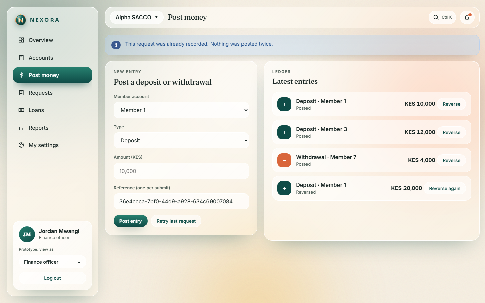
3. **No fake data in a real chart.** If the API has no history series, the chart shows the empty state "No history yet." The harness sample data (`savings`, `deposits`...) is for the harness only.
4. **The server's 400 and 409 sentences are shown as they are** ("Insufficient funds."). `describe()` does that.
5. Permissions decide what shows: `can('savings.post')` for Post money and Requests, `can('savings.request')` for Deposit and Withdraw, `can('loan.approve')` for Approve, and so on. Never check role names.
6. **A request is not money.** On Deposit and Withdraw nothing changes the balance. The member sends a request; an officer confirms it on Requests; only then does the ledger change (the backend does that on confirm).
7. Style with Tailwind utilities and the theme tokens (`bg-cream`, `text-ink`, `text-muted`, `text-err`, `font-serif`), plus the shared classes (`glass`, `btn`, `chip`, `seg`, `banner`, `table-wrap`). No hex colours.

## 4. Steps (do in order; each ends with a Check)

### S1. Overview, SACCO version

Picture: 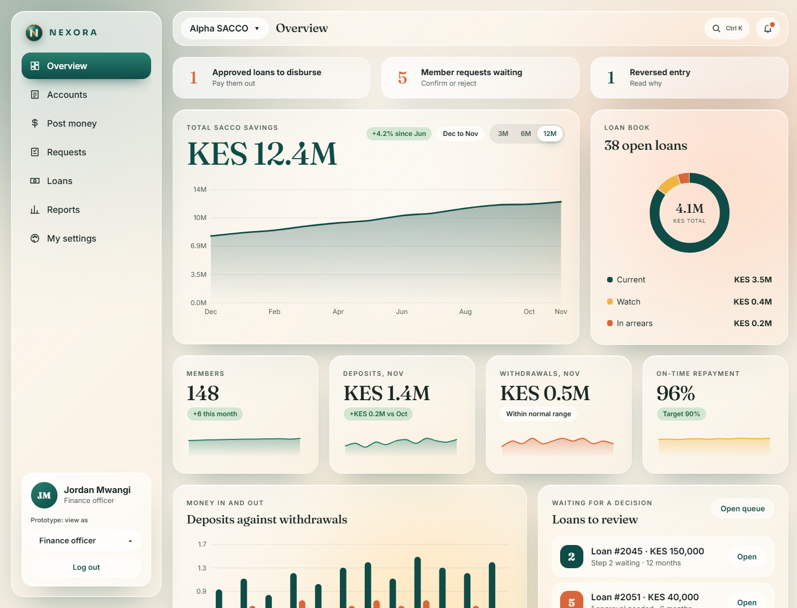

`OverviewPage` picks `SaccoOverview` when the person has `report.view` (loans officer, finance, secretary, SACCO admin) and `MemberOverview` otherwise (member). SACCO version: four stat tiles with a count-up number (`countUp` in `lib/format.js`), a savings line chart (`renderLine`), a deposits-versus-withdrawals bars chart (`renderBars`), a loan-book donut (`renderDonut`), and a "Waiting for you" list where **each row is clickable** and opens the record: `navigate('/loans', { open: 'loan:2045' })`; `LoansPage` reads it with `takeOpen('loan')`.

API: `getSummary(saccoId)` = `GET /admin/saccos/<id>/reports/summary`, plus `listLoans(saccoId,'requested')`. Mock: build from `mocks/data.js`.

Check: Loans officer, Finance, Secretary and SACCO admin all see it (harness role picker); there is **no "My account" switch** on it for staff (staff have no personal account view); tiles count up once; clicking a waiting row opens that loan's details.

### S2. Overview, member version

Picture: 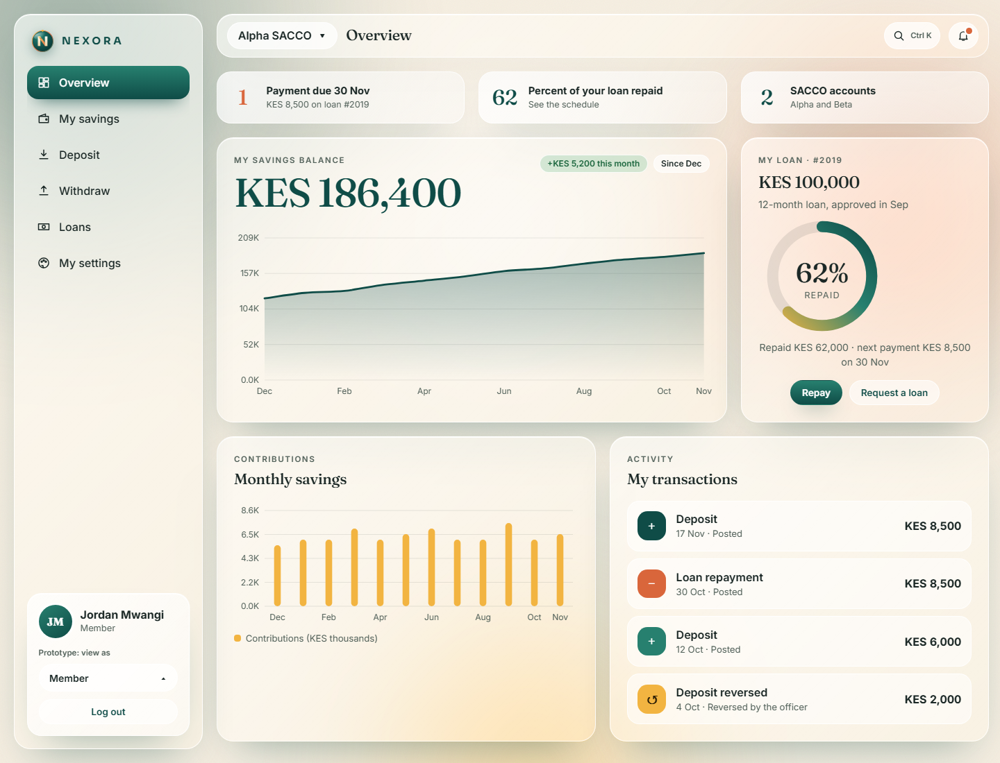

A big balance ring (`renderRing`), "My loan" progress, next repayment (date and amount), recent activity. Data: `GET /savings/accounts/me`, the member's own loan from `GET /loans/saccos/<id>`.

Check: Member role in the harness sees this version only.

### S3. My savings (members only: staff do not have it)

Picture: 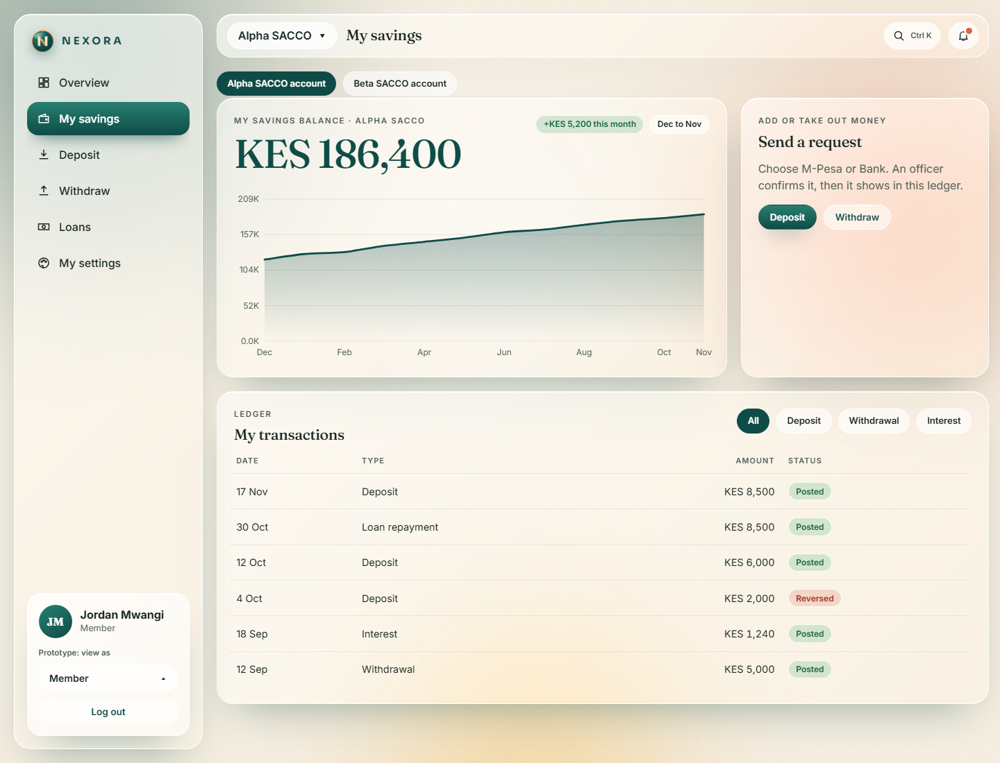

Balance, a 12-month line chart, and the member's transactions list with **Load more**. A member sends money requests from the **Deposit** and **Withdraw** pages (next steps), so this page has a small card **"Add or take out money"** with two buttons, **Deposit** and **Withdraw**, that go to `/deposit` and `/withdraw` (`navigate('/deposit')`). The text on the card: "Choose M-Pesa or Bank. An officer confirms it, then it shows in this ledger." Do **not** put a deposit form on this page.

API: `GET /savings/accounts/me`, `GET /savings/accounts/<id>/transactions`.

Check: all four states (loading, empty "No transactions yet.", error with Try again, ready); both buttons open the right page; the card is visible only when `can('savings.request')`. **My savings belongs to the member.** The loans officer, finance officer, secretary and SACCO admin do not have this page in their menu: the SACCO's savings are under Accounts. If a staff role types `/savings`, they get the 403 page.

### S3a. The request API and its mock (do this before S3b to S3d)

Create `src/api/requests.js`. One function per endpoint from the Master file, section 3b. Every function has the real call and a mock twin (the pattern in Common setup, 7.3). The mock keeps its own list in module memory, seeded from `paymentRequests` in `src/mocks/data.js`, so the member pages and the officers' queue see the same rows in the harness.

```js
import { http, MOCK, mockDelay, ApiError } from '../lib/http.js';
import { paymentRequests, myBalance } from '../mocks/data.js';

let rows = paymentRequests.map(r => ({ ...r }));          // the mock's memory
let nextId = 100;

/* member */
export async function createRequest(saccoId, body) {
  // body: { kind, method, amount (shillings), phone | bank_name + account_ref, reference }
  if (MOCK) {
    await mockDelay();
    const again = rows.find(r => r.reference === body.reference);
    if (again) return again;                               // the same reference twice returns the first one
    if (body.kind === 'withdrawal' && body.amount > myBalance) throw new ApiError(409, 'Insufficient funds.', 'INSUFFICIENT_FUNDS');
    const row = { id: nextId++, who: 'Jordan Mwangi', mine: true, status: 'pending', created: 'Today', ...body };
    rows = [row, ...rows]; return row;
  }
  return http.post('/savings/requests', { sacco_id: saccoId, ...body, amount: toMinor(body.amount) });   // import toMinor from lib/format.js
}
export async function listMyRequests(saccoId, kind) {
  if (MOCK) { await mockDelay(); return rows.filter(r => r.mine && r.kind === kind); }
  return http.get(`/savings/requests/me?sacco_id=${saccoId}&kind=${kind}`);
}

/* officers */
export async function listSaccoRequests(saccoId, status) {
  if (MOCK) { await mockDelay(); return rows.filter(r => !status || r.status === status); }
  return http.get(`/savings/saccos/${saccoId}/requests${status ? `?status=${status}` : ''}`);
}
export async function confirmRequest(id, reference) {
  if (MOCK) {
    await mockDelay(); const r = rows.find(x => x.id === id);
    if (r.status !== 'pending') throw new ApiError(409, 'This request was already decided.', 'REQUEST_ALREADY_DECIDED');
    if (r.mine) throw new ApiError(403, 'You cannot decide your own request.', 'OWN_REQUEST');
    if (r.kind === 'withdrawal' && r.amount > 50000) throw new ApiError(409, 'Insufficient funds.', 'INSUFFICIENT_FUNDS');
    r.status = 'confirmed'; return r;
  }
  return http.post(`/savings/requests/${id}/confirm`, { reference });
}
export async function rejectRequest(id, reason) {
  if (MOCK) { await mockDelay(); const r = rows.find(x => x.id === id); if (r.status !== 'pending') throw new ApiError(409, 'This request was already decided.', 'REQUEST_ALREADY_DECIDED'); r.status = 'rejected'; r.reject_reason = reason; return r; }
  return http.post(`/savings/requests/${id}/reject`, { reason });
}
```

Check: in the browser console of the harness (or a tiny test page) `createRequest(1, {...})` twice with the same `reference` returns the same row and the list has one new item, not two.

### S3b. The Deposit page (members, route `deposit`)

Pictures: M-Pesa 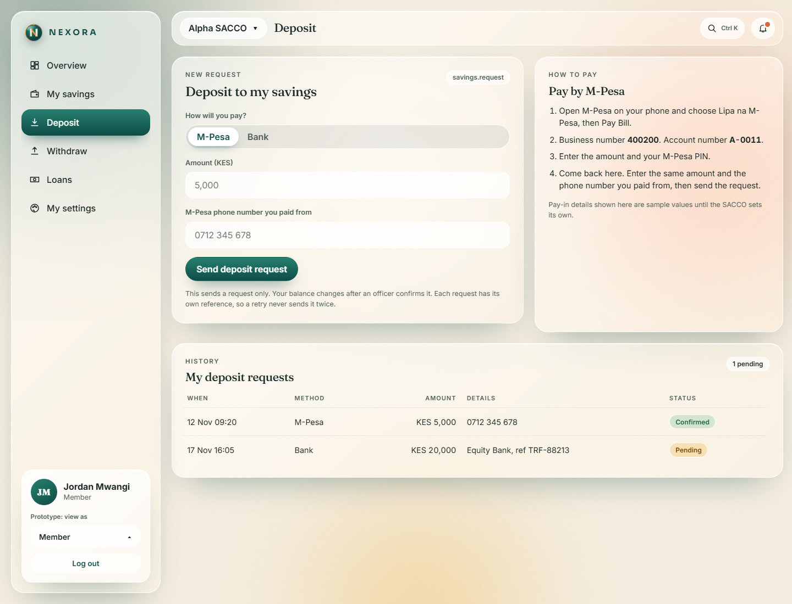 Bank 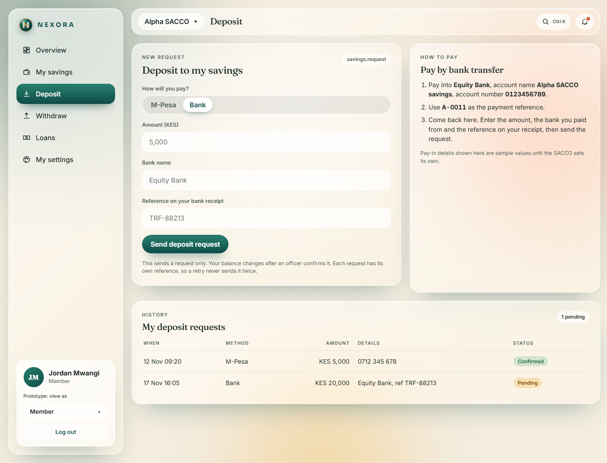 field errors 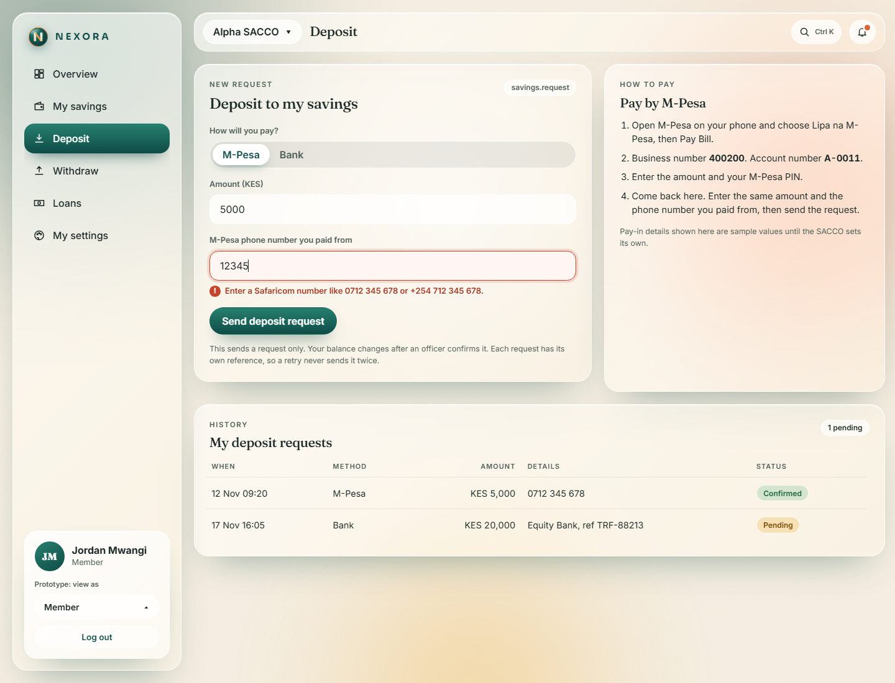 sent 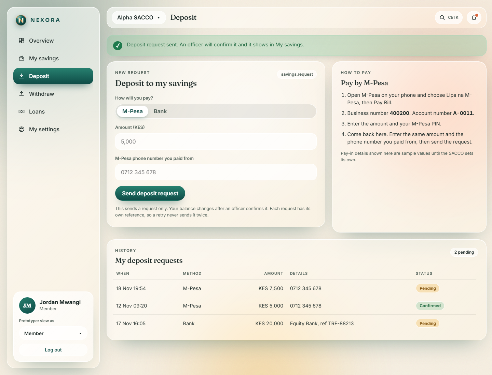 phone 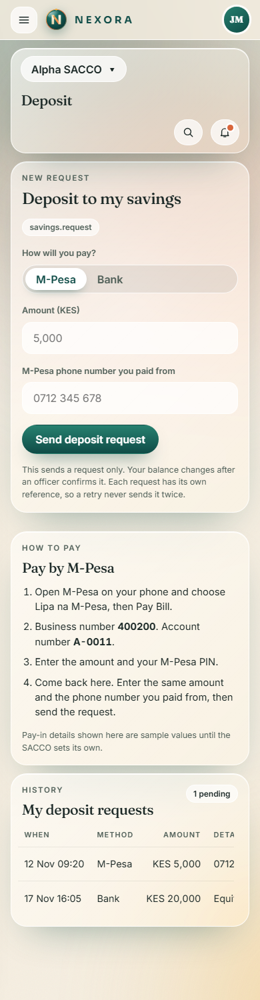

Permission: `savings.request` (members only). The page is in the member's menu between My savings and Withdraw. It is a menu page, so it has **no Back button**.

**Layout.** A 12-column grid on desktop (`grid gap-4 lg:grid-cols-12`), one column on phone:
- left card, 7 columns (`lg:col-span-7`, class `glass`): the form "Deposit to my savings";
- right card, 5 columns: **How to pay**, which changes with the method;
- full-width card under them: **History** "My deposit requests".

**The form, top to bottom (each is a `Field` from `components/Field.jsx`):**
1. **How will you pay?** a two-option switch with the shared `.seg` class and `role="tablist"`: **M-Pesa** and **Bank**. M-Pesa is selected first. Switching shows or hides the fields below **without** losing the amount the person already typed (keep all values in state; do not re-mount the form).
2. **Amount (KES)**: `inputMode="numeric"`, placeholder `5,000`. Whole shillings. Parse with `parseAmount()` from `lib/format.js`.
3. If M-Pesa: **M-Pesa phone number you paid from**: `inputMode="tel"`, placeholder `0712 345 678`.
4. If Bank: **Bank name** (placeholder `Equity Bank`) and **Reference on your bank receipt** (placeholder `TRF-88213`).
5. Button **Send deposit request** (class `btn`), disabled and reading "Sending..." while the request is in flight.
6. Under the button, a small note: "This sends a request only. Your balance changes after an officer confirms it. Each request has its own reference, so a retry never sends it twice."

**Validation (before sending; show the message under the field with `Field`, focus the first bad field, send nothing):**
| Field | Rule | Message |
|---|---|---|
| Amount | a number greater than 0 | `Enter an amount greater than zero.` |
| Phone (M-Pesa) | after removing spaces and dashes: starts with `0`, `254` or `+254`, then a `7` or `1`, then 8 more digits (the pattern is written below the table) | `Enter a Safaricom number like 0712 345 678 or +254 712 345 678.` |
| Bank name | at least 2 characters | `Enter the name of the bank.` |
| Bank reference | at least 3 characters | `Enter the reference from your bank receipt.` |

The phone pattern, as a regular expression to paste: `/^(?:\+254|254|0)([17]\d{8})$/` (test it on the string with spaces and dashes already removed).

Phone formats that must be accepted: `0712345678`, `0712 345 678`, `0112345678`, `+254712345678`, `+254 712 345 678`, `254712345678`. Show it back as `0712 345 678`. Send it to the API in the same cleaned form the Master file describes (`254712345678`); the mock keeps the pretty form.

**How to pay card** (text, from `payIn` in `mocks/data.js`; it is sample data, say so in a small note "Pay-in details shown here are sample values until the SACCO sets its own."):
- M-Pesa: 1. Open M-Pesa on your phone and choose Lipa na M-Pesa, then Pay Bill. 2. Business number **400200**, account number **A-0011**. 3. Enter the amount and your M-Pesa PIN. 4. Come back here, enter the same amount and the phone number you paid from, then send the request.
- Bank: 1. Pay into **Equity Bank**, account name **Alpha SACCO savings**, account number **0123456789**. 2. Use **A-0011** as the payment reference. 3. Come back here, enter the amount, the bank you paid from and the reference on your receipt, then send the request.

**Submit and the safe retry.** Create `reference` with `newReference()` when the page opens and keep it in state. Call `createRequest(saccoId, { kind: 'deposit', method, amount, phone | bank_name + account_ref, reference })`. If the network fails, keep the form filled, show the banner "We could not confirm that went through. Press Send again; it will not be sent twice." and **reuse the same reference**. Only after a success, create a new reference.

**Success state.** A green banner above the cards (`ErrorBanner` kind `ok`): **"Deposit request sent. An officer will confirm it and it shows in My savings."** The form empties, the amount field is ready for a new request, the page scrolls smoothly to the top, and the new request is the first row of History with a **Pending** chip.

**History card:** a table (`table-wrap`) with columns When, Method, Amount (right aligned, `KES 5,000`), Details (the phone number, or `Equity Bank, ref TRF-88213`), Status. Status chips: **Pending** (`chip warn`), **Confirmed** (`chip up`), **Rejected** (`chip bad`) and under a rejected row the reason in small muted text: `Reason: ...`. The header shows "N pending". Empty state: "You have not sent a deposit request yet." Loading: shimmer rows (`Loading`). Error: banner with Try again. Load more if `next`.

**Errors from the server:** 400 sentence under the form; 403 shows the 403 page; 423 the suspended page; 429 and the rest through `describe()`.

Check, as Member in the harness: M-Pesa and Bank both submit; each field error appears with the exact message; a second press on Send while sending does nothing; the success banner and the new Pending row appear; at 375 px nothing scrolls sideways and the switch and the button are at least 2.75 rem tall; as Finance officer typing `/deposit` shows the 403 page.

### S3c. The Withdraw page (members, route `withdraw`)

Pictures: M-Pesa 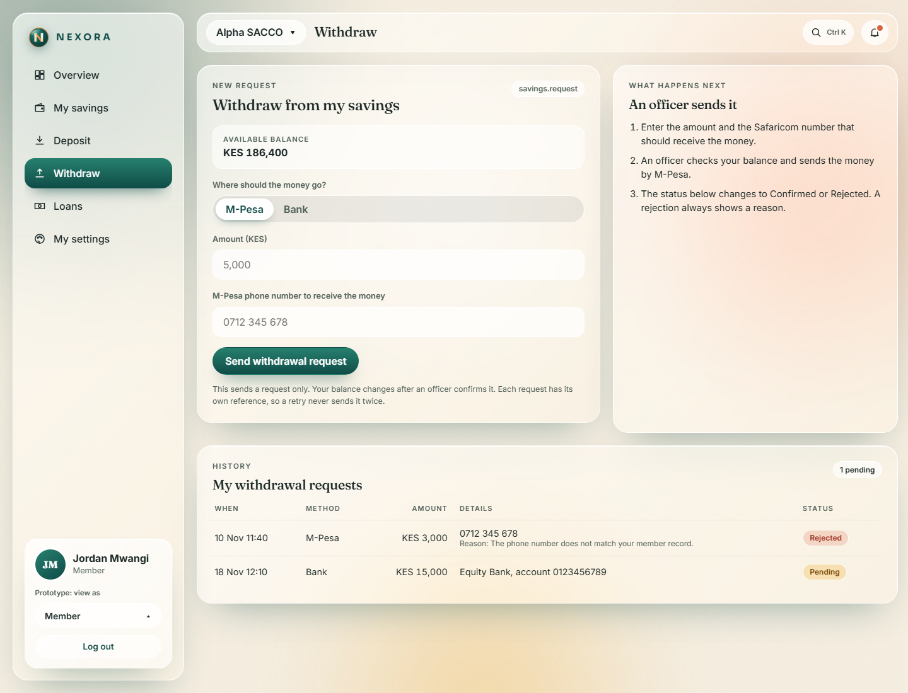 more than the balance 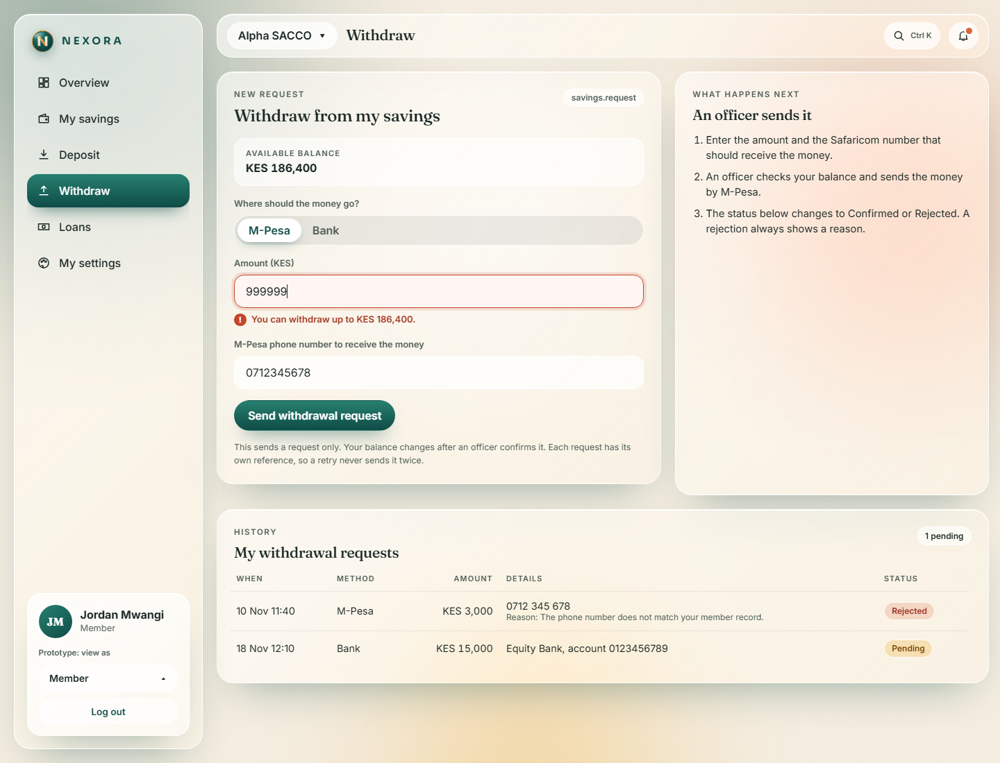 Bank 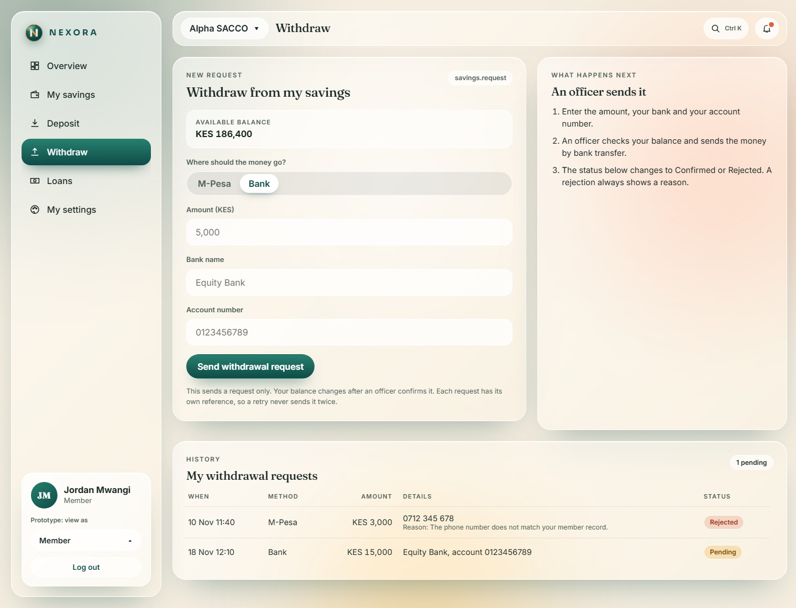 sent 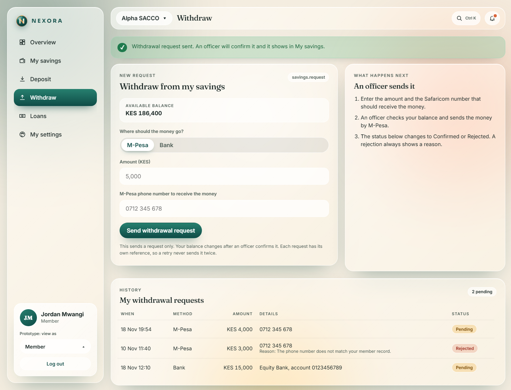

Same layout, same components, same states as Deposit (copy the structure; share the pieces by putting `MethodSwitch.jsx` and `RequestHistory.jsx` in your `requests/` folder). The differences:
1. Title "Withdraw from my savings". Above the switch a stat tile **Available balance** `KES 186,400` (from `GET /savings/accounts/me`, shown with `kesFromMinor`; the mock uses `myBalance`).
2. The switch asks **Where should the money go?** with **M-Pesa** and **Bank**.
3. M-Pesa: **M-Pesa phone number to receive the money** (same phone rule). Bank: **Bank name** and **Account number** (digits only, 6 to 20, spaces ignored; message `Enter your account number, 6 to 20 digits.`).
4. **Amount rule:** not above the balance. Field error under Amount: `You can withdraw up to KES 186,400.` Show it before sending. The server may still answer `409 INSUFFICIENT_FUNDS` (balance changed): show its sentence in a banner above the button.
5. Right card is "What happens next": 1. Enter the amount and where the money should go. 2. An officer checks your balance and sends the money. 3. The status below changes to Confirmed or Rejected. A rejection always shows a reason.
6. Success banner: **"Withdrawal request sent. An officer will confirm it and it shows in My savings."** History title "My withdrawal requests", empty text "You have not sent a withdrawal request yet."
7. `kind` is `withdrawal` in the call. Pending withdrawals are **not** subtracted from the balance on screen (the officer checks the balance when confirming); say nothing about it.

Check: 999,999 shows the balance error and sends nothing; 4,000 to `+254712345678` sends and shows a Pending row; Bank needs both fields.

### S3d. The Requests queue (officers, route `requests`)

Pictures: queue 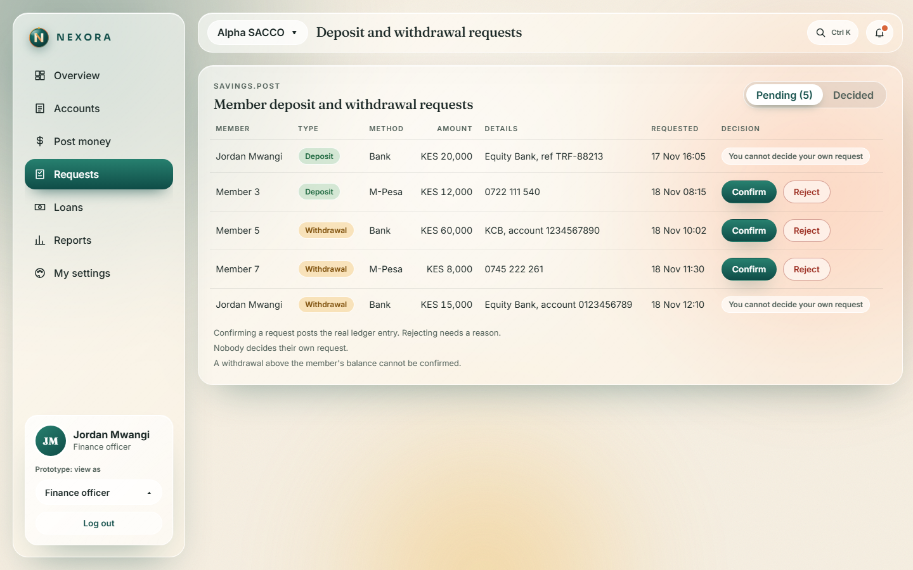 reject 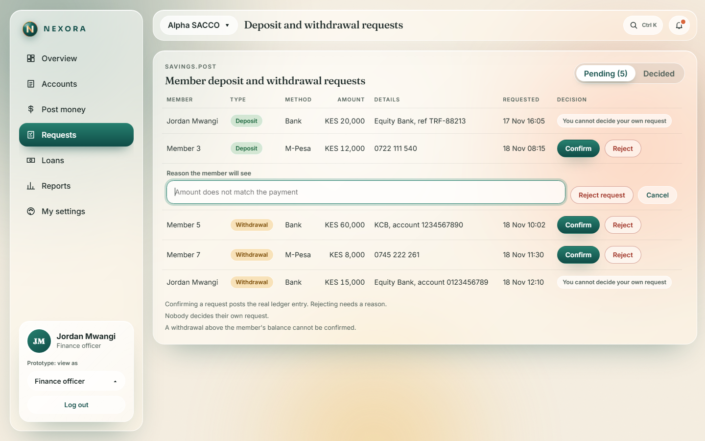 confirmed 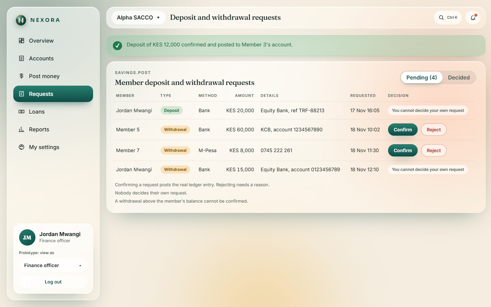 over balance 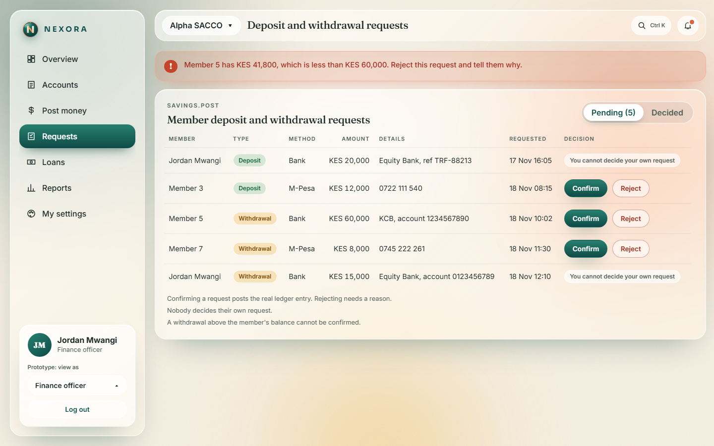 decided 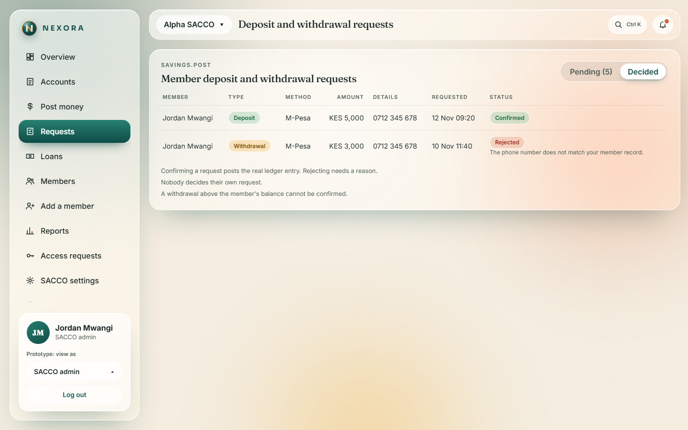 phone 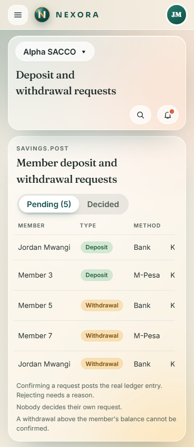

Permission: `savings.post` (Finance officer and SACCO admin). It is in their menu right after Post money, so no Back button.

**Layout:** one full-width `glass` card. Header: eyebrow `savings.post`, title **Member deposit and withdrawal requests**, and on the right a two-option `.seg` filter: **Pending (3)** and **Decided**. Below, a table with columns Member, Type (chip: Deposit `chip up`, Withdrawal `chip warn`), Method, Amount, Details, Requested, and Decision. At the bottom three short rules in the shared `.rules` style: "Confirming a request posts the real ledger entry. Rejecting needs a reason." "Nobody decides their own request." "A withdrawal above the member's balance cannot be confirmed."

**Pending rows** show two buttons in the Decision column: **Confirm** (`btn small`) and **Reject** (`btn warn small`).
- **Confirm:** call `confirmRequest(id, newReference())`. While sending, the row's buttons are disabled. On success: green banner "Deposit of KES 12,000 confirmed and posted to Member 3's account." (or "Withdrawal of ..."), the row leaves Pending and shows under Decided as **Confirmed**, and the Pending count drops. On `409 INSUFFICIENT_FUNDS` show a red banner with the server sentence and keep the row pending ("Member 5 has KES 41,800, which is less than KES 60,000. Reject this request and tell them why." is the prototype's wording: build it from the amount and the account balance when you have it, otherwise use the server sentence). On `409 REQUEST_ALREADY_DECIDED` show "Someone already decided this request." and reload the list.
- **Reject:** the button opens an extra row under that request with one field **Reason the member will see** and two buttons, **Reject request** and **Cancel**. An empty reason shows `Write a reason before you reject this request.` under the field. On success a green banner "Request from Member 3 rejected. They can see your reason." and the row moves to Decided as **Rejected** with the reason in small muted text.
- **Your own request:** if the request is the signed-in officer's own (same membership as the requester), the Decision column shows the grey chip "You cannot decide your own request" and **no buttons**.

**Decided tab:** the same table without buttons; the last column is the status chip and the reason for rejected ones.

**States:** loading shimmer; empty Pending: "No requests are waiting. New member requests appear here."; empty Decided: "No decided requests yet."; error: banner with Try again. Load more if `next`. On phone the table scrolls inside its own box (`table-wrap`), nothing else scrolls sideways.

**Dashboard link:** the Finance officer and SACCO admin Overview has a "Member requests waiting" tile with the pending count that opens `/requests` (`navigate('/requests')`). Add it to the "Waiting for you" tiles in S1.

Check: as Finance officer confirm one request and reject one with a reason; the numbers update; the confirmed deposit raises the member's balance in the mock accounts list; as a Member open `/requests` and see the 403 page.
### S4. Accounts and the ledger

Pictures: 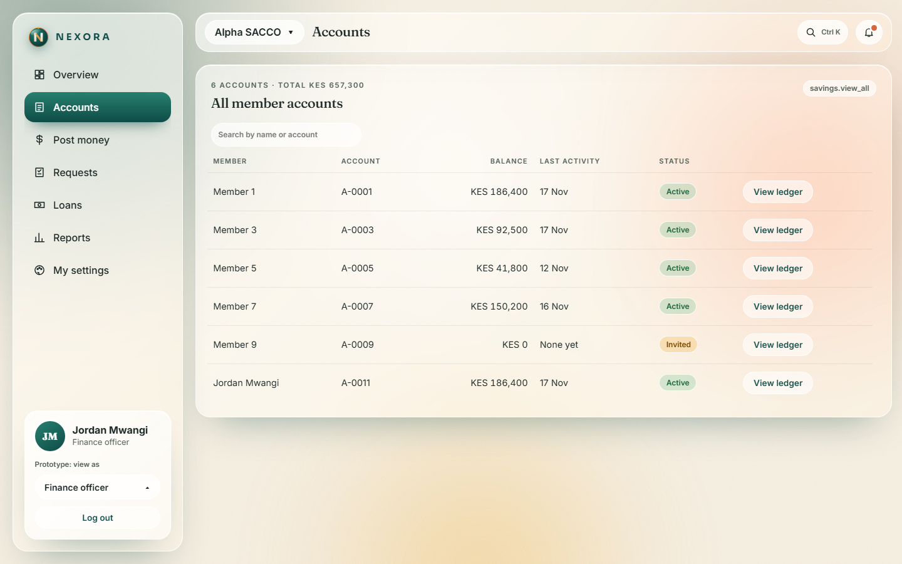 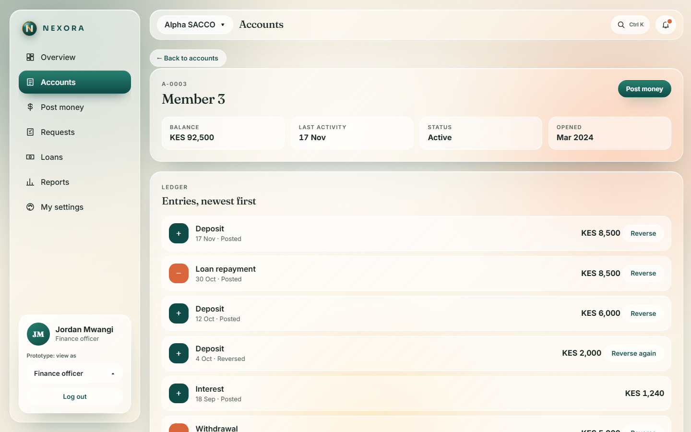

`AccountsPage`: searchable list of member accounts (`GET /admin/saccos/<id>/accounts`), each row opens `LedgerPage` for that account. **`LedgerPage` is a drill-down, so it has a Back button labelled "Back to accounts"** (use `BackButton`). Ledger: balance header, filter chips (All, Deposits, Withdrawals, Reversed), list of transactions with `StatusChip` (Posted / Reversed), Load more. Officers with `savings.reverse` get a **Reverse** button on a posted row (opens a small dialog asking for a reason, sends `POST /savings/transactions/<id>/reversals` with a new reference). Already reversed: the 409 sentence shows in a banner: 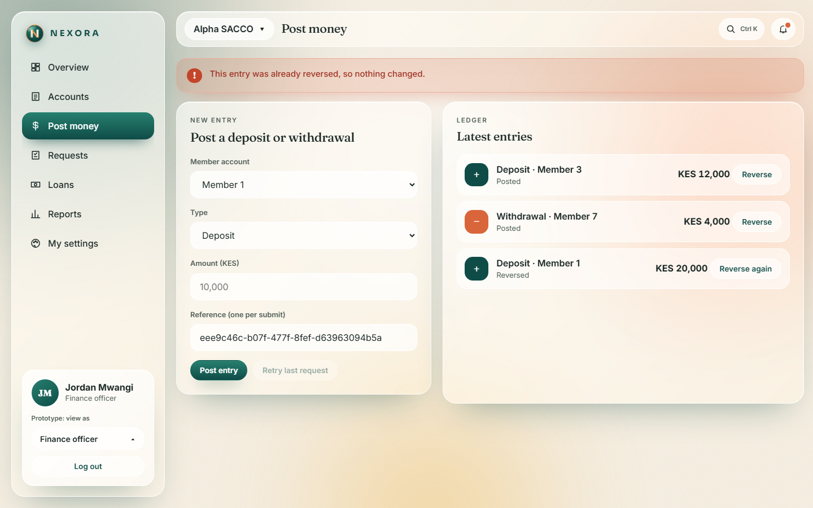.

Check: reversing twice shows the red banner, not a crash; the row turns to Reversed after success.

### S5. Post money

Pictures: 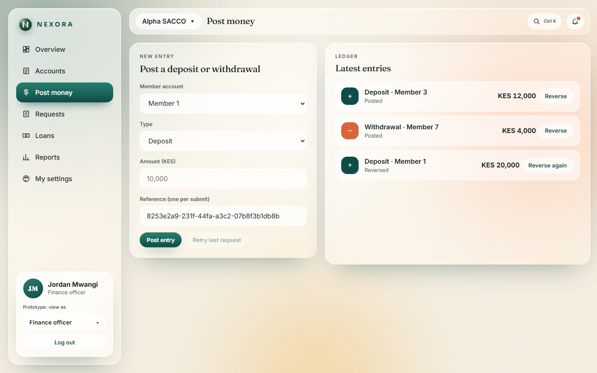  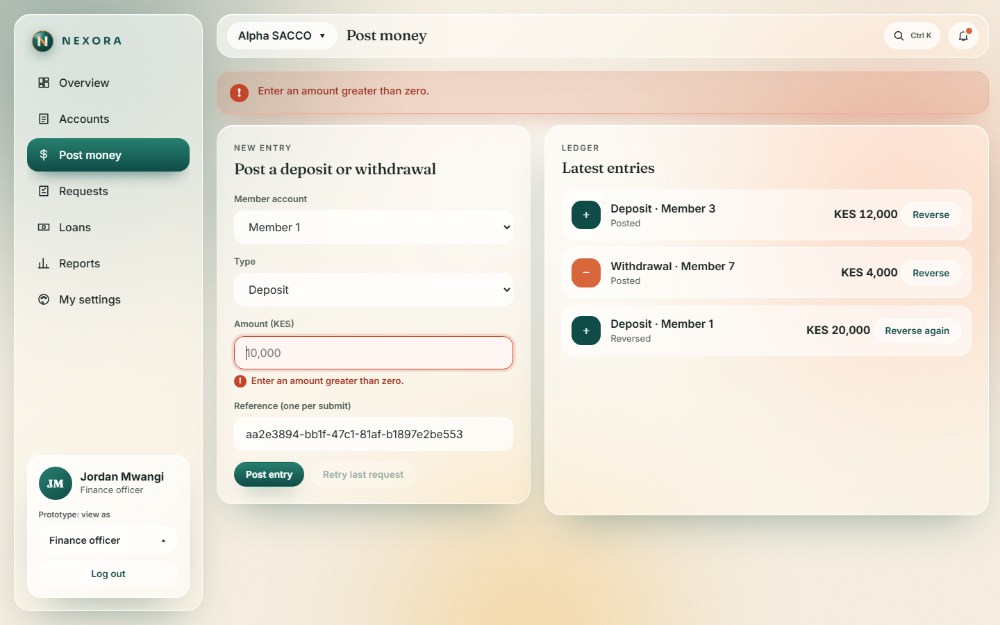

A form: pick the member's account (search), pick Deposit or Withdrawal, amount in KES, optional note. Validation (before sending): account chosen, amount greater than zero, at most 2 decimals; show the message under the field with `Field`. Submit sends `POST /savings/accounts/<id>/deposits` or `/withdrawals` with `{ amount: toMinor(x), reference, note }`. Button shows "Posting..." and is disabled while sending. On a network failure the form **stays filled** and a banner says "We could not confirm that went through. Press Post again; it will not be posted twice." (the same reference is reused). On success: green toast, form clears, new reference. Withdrawal over the balance: `409 INSUFFICIENT_FUNDS` shows the server sentence in a banner above the button.

Check: press Post twice fast (mock): only one entry. Force a failure then retry: same reference sent (log it once in the mock to prove).

### S6. Loans

Pictures: officer 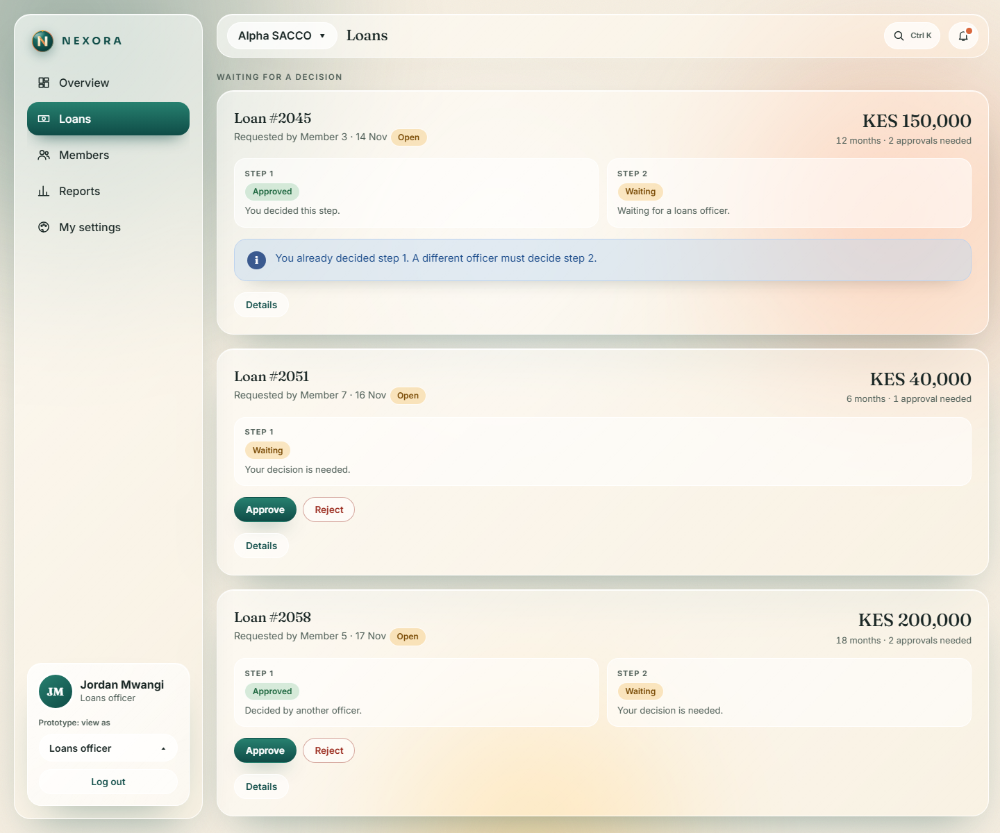 member 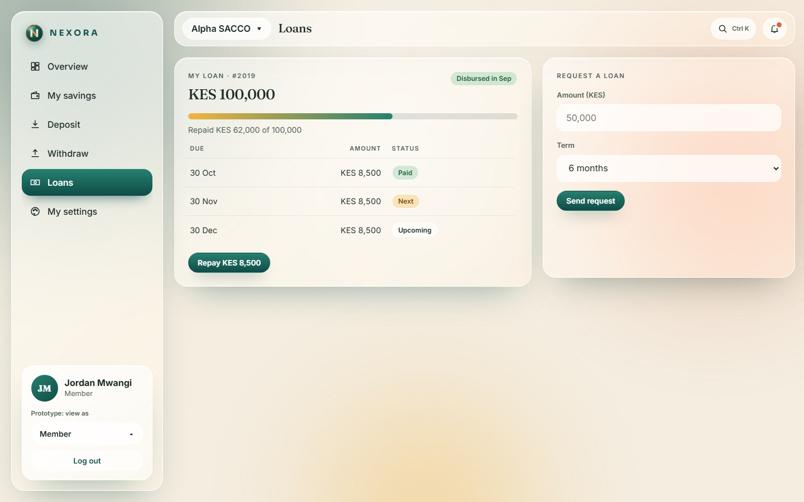 finance 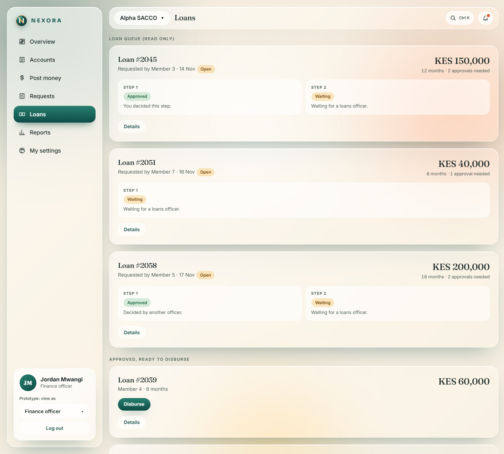 detail 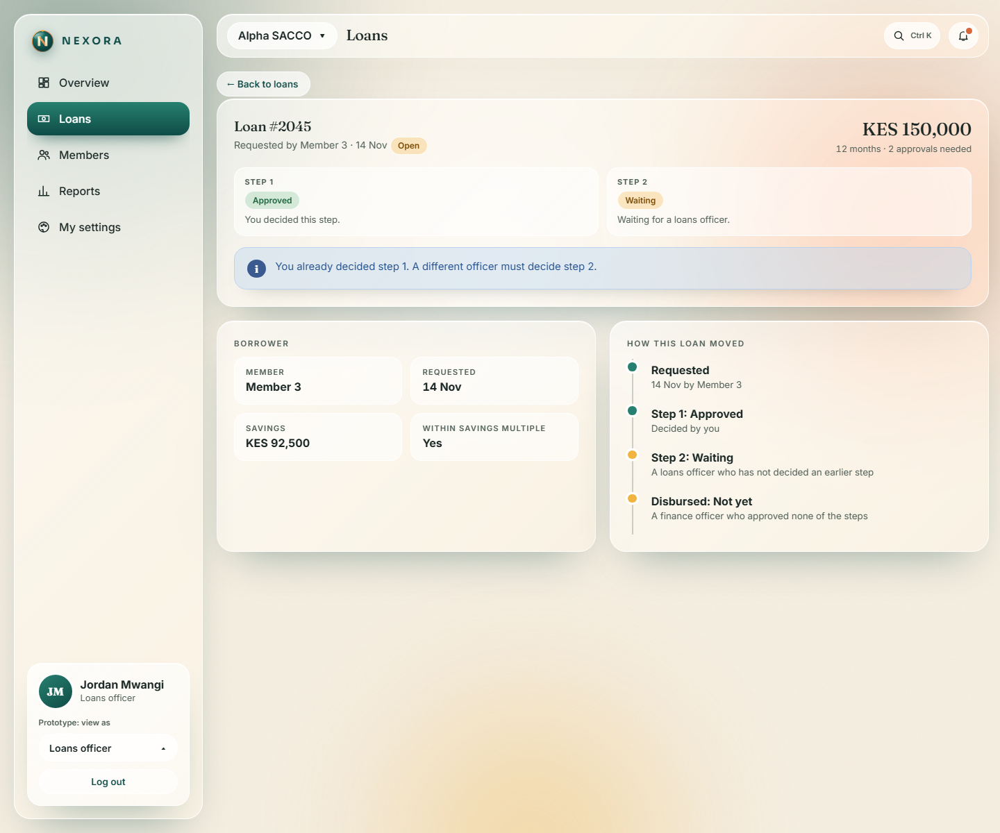

One route, three jobs by permission:

- Everyone with `loan.view`: the list with status filter chips (All, Waiting, Approved, Disbursed, Repaid, Rejected; pass `?status=` to the API; Neo adds that filter, so **also filter in the mock and, until Neo's change is merged, filter client-side**).
- `loan.request` (member): a **Request a loan** button opening `LoanRequest` (amount, term in months, shows the repayment estimate). `POST /loans/saccos/<id>` with `{ principal: toMinor(x), term_months }`.
- Clicking a row opens `LoanDetail` (**Back to loans**): amount, term, status chip, a timeline of `decisions` (step, decision, reason, who, when), the repayment schedule, and the action buttons the person is allowed:
  - `loan.approve` and status Waiting: **Approve** and **Reject**, both asking for a reason (`POST /loans/<id>/decisions` with `{ step, decision, reason }`). The server may answer `LOAN_SAME_OFFICER` (403): show "A different officer must give the second approval."
  - `loan.disburse` and status Approved: **Disburse** (`/disbursements`, `{reference}`). `LOAN_NEEDS_APPROVAL` 409 shows its sentence.
  - `loan.repay` and status Disbursed: **Record repayment** (`/repayments`, `{reference, amount}`).

A role with neither `loan.view` nor `loan.request` has no Loans item in its menu at all.

Check: log in as each role in the harness and confirm the buttons that appear match the permissions above; a member cannot see Approve.

### S7. Reports

Picture: 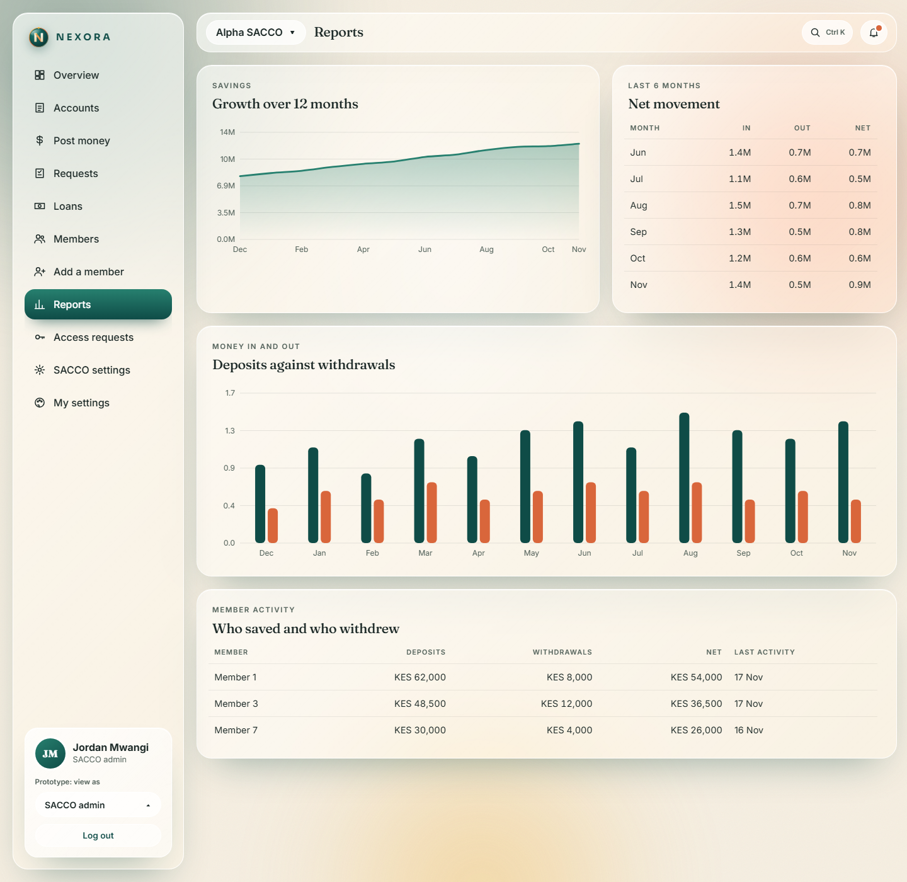

Summary tiles plus the member-activity table (sortable by clicking the header; sort arrow shown), a period filter, and a **Print** button (`window.print()`; the shared print block in `nexora-2.css` already makes it black on white in every theme, so in `sam.css` only hide the buttons and filters when printing). Data: `GET /admin/saccos/<id>/reports/summary` and `/reports/member-activity`.

### S8. Harness, test, hand in

Register all nine pages in `registry.sam.js`. Run the **11-point check** on each page for each role that may open it (use the role table in the Master file). Check units: search your CSS for `px` and fix any that are not borders or shadows. Take the photos. Open the PR.

## 4b. Scenarios for the money pages (how each is handled)

These cases come from "How people get in" and "Problems and how each is handled" in the Master file. Build the answer for every row and take a photo of it.

| Scenario | What the person sees | What your code does |
|---|---|---|
| A new member who has joined but has no savings account yet | My savings: balance KES 0 and the sentence "Your savings account opens when an officer posts your first deposit." Deposit is allowed (a request) | `GET /savings/accounts/me` returns none: show the empty state, not an error; Withdraw shows "You have no balance to withdraw." and disables Send |
| The person belongs to two SACCOs | the SACCO switcher decides; every page loads the current `saccoId` only | pass `saccoId` to every API function; never mix data between SACCOs; reload when it changes |
| The role changes while the page is open (an admin made a member an officer) | after the next page change the menu and buttons match | read `can()` fresh on each render; never store it |
| The SACCO is suspended while the member fills the Deposit form | the 423 page replaces the page and says the records are locked | the 423 answer on the send; keep nothing, say nothing was sent |
| The member sends two deposit requests for the same amount on purpose | two requests, two history rows | different `reference` for each form open, so the server accepts both |
| The member presses Send twice quickly | one request | disabled button; same `reference` |
| The officer opens Requests and the list changes (another officer decides one) | the row disappears or becomes decided after the next reload; a banner "Someone already decided this request." if they press Confirm on it | handle `409 REQUEST_ALREADY_DECIDED` and reload the list |
| The officer is also a member and has their own requests | their own rows have no buttons: "You cannot decide your own request" | compare the requester with the signed-in membership |
| Confirm a withdrawal above the member's balance | red banner with the server sentence; the request stays Pending; the officer can Reject with a reason | `409 INSUFFICIENT_FUNDS` |
| Reject without a reason | message under the reason field | frontend check, then 400 |
| A loan decision by the same officer twice | "A different officer must give the second approval." | `LOAN_SAME_OFFICER` 403 |
| Reverse a transaction twice | the red banner "This entry was already reversed" | 409 sentence |
| The platform owner opens a money page by typing the address | the 403 page | `guardRoute` |
| The API has no history for a chart | "No history yet." in the chart card | never invent numbers |
| The page loads while offline | the Offline page, and Try again works when the connection returns | `describe()` code `offline` |
| The person changes the colour theme or font | everything stays readable, the chips, banners, charts and tables follow the theme | theme tokens only; check the Ink theme |

## 5. Test as every role

| Role | Must see | Must NOT see |
|---|---|---|
| Member | Overview (member), My savings, **Deposit, Withdraw**, Loans (own, with Request) | Accounts, Post money, Requests, Reports, Approve/Disburse buttons |
| Loans officer | Overview (SACCO), Loans with Approve/Reject, Reports | My savings, Post money, Requests, Deposit, Withdraw, Disburse, Reverse |
| Finance officer | Overview (SACCO), Accounts, Post money, **Requests (Confirm, Reject)**, Reverse, Loans with Disburse/Repay, Reports | My savings, Approve/Reject, Deposit, Withdraw (typing /savings or /deposit gives 403) |
| Secretary | Overview (SACCO), Accounts (read), Loans (read), Reports | My savings, Post money, Requests, Deposit, Withdraw, any action button |
| SACCO admin | Overview (SACCO), Accounts, Post money, **Requests**, Loans (read), Reports | My savings, Approve, Disburse, Deposit, Withdraw |
| Platform owner | none of your pages (menu has no money items; typing `/loans` gives 403) | all |

## 6. Photos to hand in (in `docs/frontend/done/sam/`)

For `overview` (SACCO and member), `savings`, `deposit` (M-Pesa, Bank, errors, sent), `withdraw` (M-Pesa, over-balance, Bank, sent), `requests` (pending, reject reason, confirmed, over-balance, decided), `accounts`, `ledger`, `money`, `loans` (as three roles), `loan-detail`, `reports`: a `-ready-1280.png` and a `-ready-375.png`. Plus `-loading`, `-empty`, `-error` for `loans`, `accounts` and `savings`. Plus `money-field-error-1280.png`, `money-banner-409-1280.png`, `money-retry-1280.png`.

## 7. Done checklist (paste into your pull request, all ticked)

- [ ] Common setup Steps 0 to 9 done; harness shows my nine pages
- [ ] Overview SACCO and member versions match pictures; rows clickable
- [ ] My savings has the Add-or-take-out card linking to Deposit and Withdraw
- [ ] Deposit and Withdraw: M-Pesa and Bank, every validation message, balance check, safe retry with one reference, success banner, history with Pending, Confirmed, Rejected chips
- [ ] Requests queue: Confirm posts, Reject needs a reason, own requests have no buttons, a withdrawal above the balance cannot be confirmed, Pending and Decided tabs, Overview tile
- [ ] Accounts and ledger with Back button on the ledger; Reverse works and handles 409
- [ ] Post money: field errors, banner errors, safe retry with the same reference, no double post
- [ ] Loans: list, filter, request, detail, approve/reject, disburse, repay, with permission-based buttons and named error codes
- [ ] Reports with sort and print
- [ ] Section 4b: every scenario row handled (no account yet, two SACCOs, role change, suspended, own requests, offline, themes)
- [ ] Minor units used on the wire; no float maths on money
- [ ] Every page has loading, empty, error (with Try again) and ready states
- [ ] 11-point check passed for every role on every page; no bare px sizes; no hex colours in className; no `role ===`; no `fetch(`
- [ ] Photos added; only my files committed

## 8. Hand-in

Push `frontend/sam`, open the pull request into `frontend`, paste this checklist, post "Sam done" in the team chat. Then answer Collins's list.
