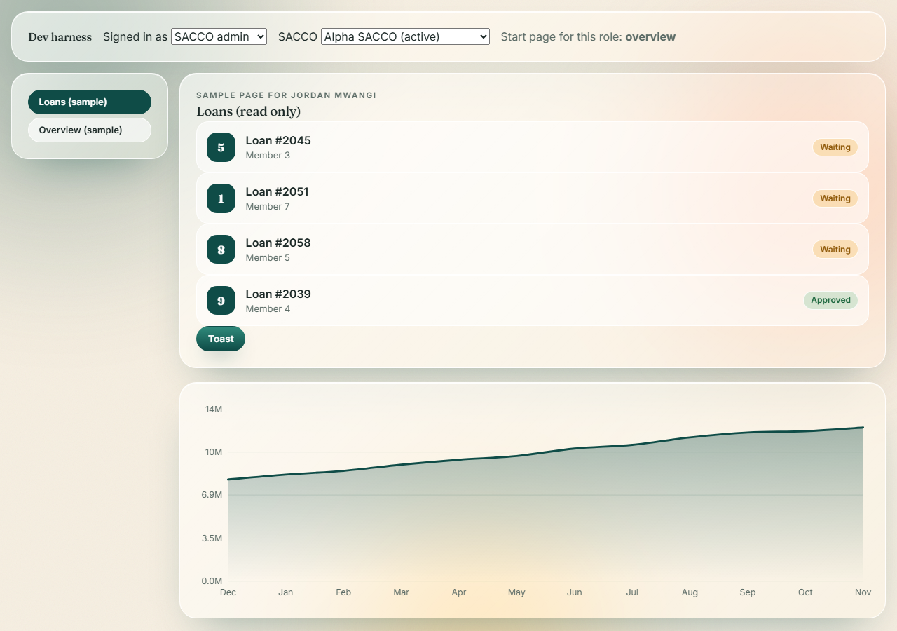
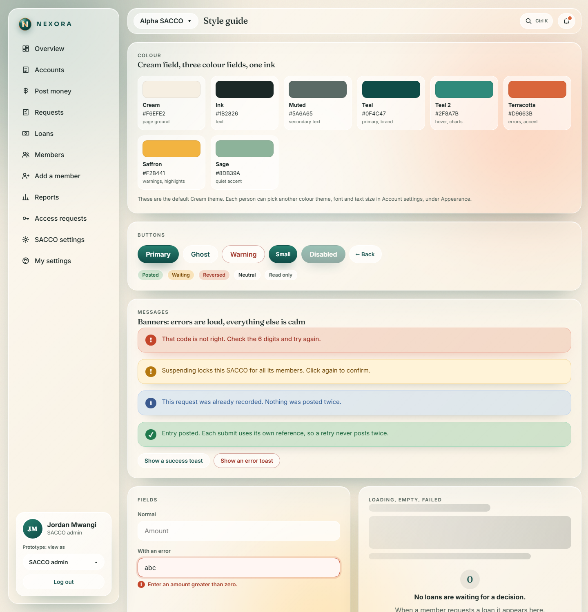
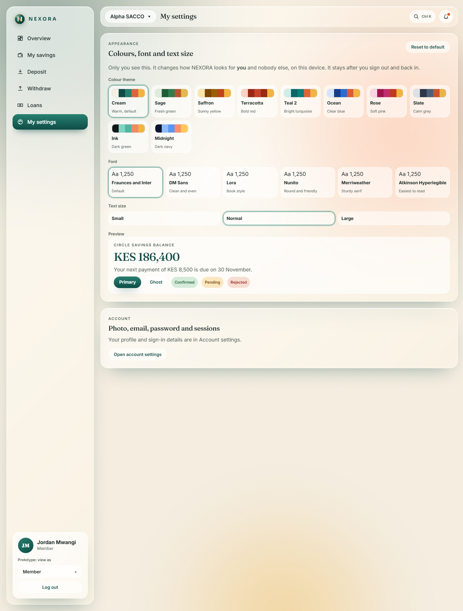
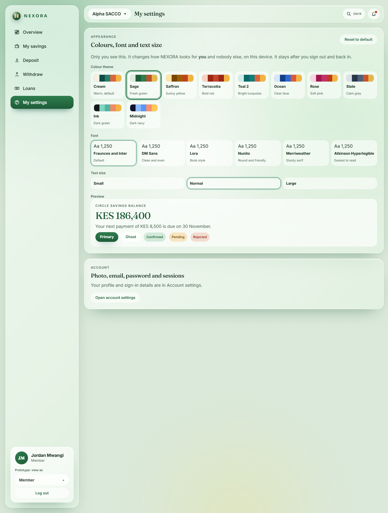
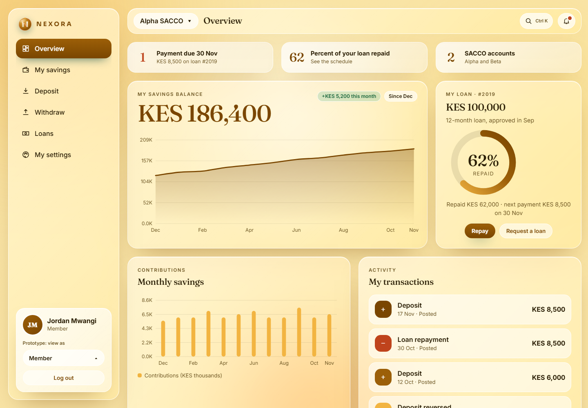
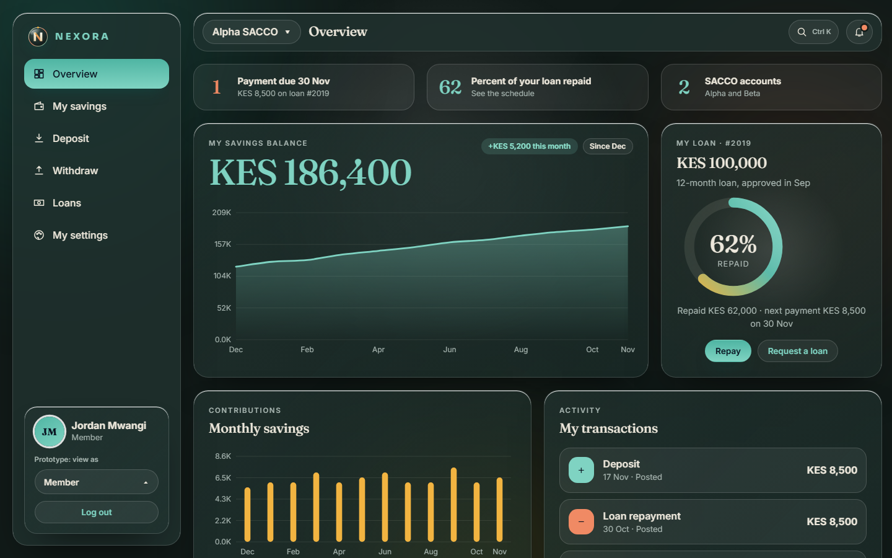
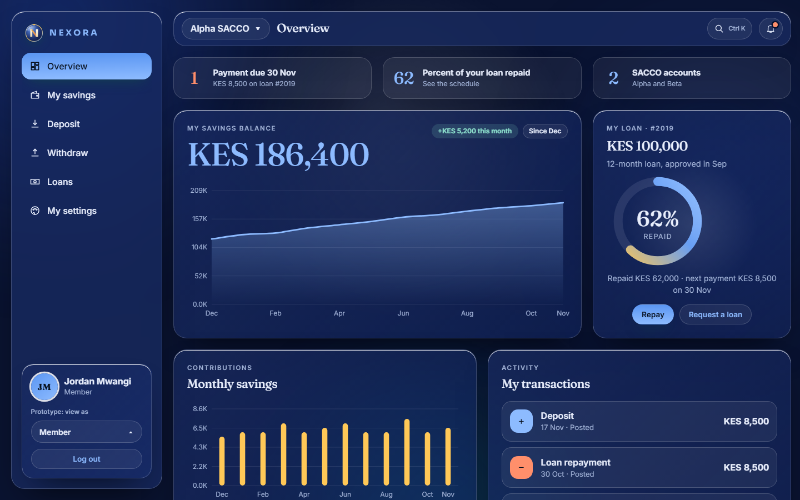
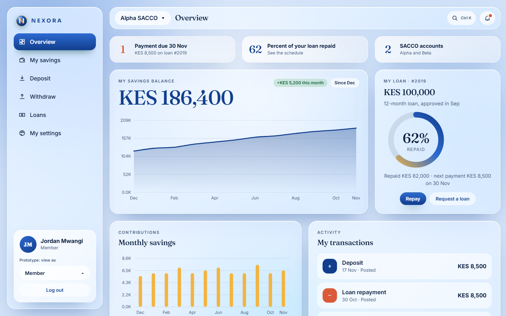
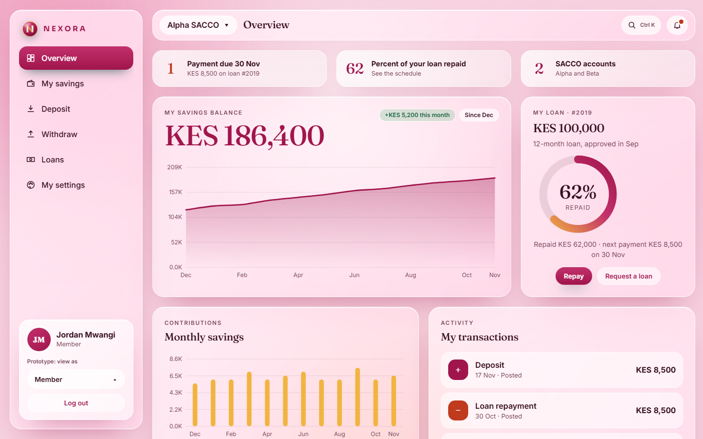
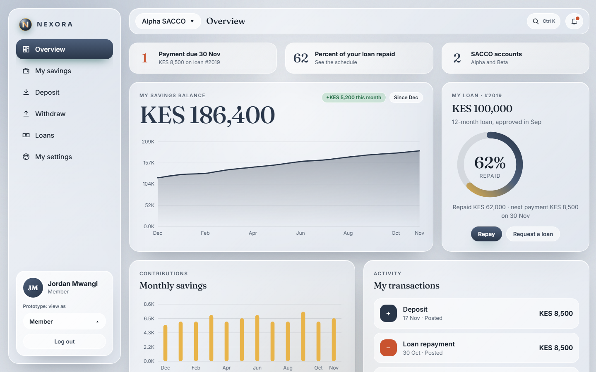

# COMMON SETUP: identical for Ryan, Neo, Sam and Collins

Read this part top to bottom **once**, then do **Steps 0 to 9 in order**. Every step ends with a **Check**. If the check does not pass, stop and fix it before the next step. Do not skip ahead.

This part is the same in all four personal files. Your own work (Part 2) starts after Step 9.

Pictures are in `docs/frontend/images/`. In the PDF the pictures are printed in place.

---

## What you are building (30 seconds)

NEXORA is a SACCO app. Members save money and take loans, officers post money and decide loans, the platform owner looks after the SACCOs. The backend (Flask + Postgres) already exists. We are building the frontend in `frontend/` with **React 19 (JavaScript, not TypeScript) and Tailwind CSS v4**, built by Vite.

A clickable **prototype** already shows exactly how every screen looks and behaves. **Your job is to rebuild your screens in React and Tailwind so they look and behave the same as the pictures, and talk to the real API.** Open the prototype and the pictures whenever you are unsure.

- Live prototype: https://claude.ai/artifact/SPDZB7PDFbRt9wDJ3cvxH7
- Same prototype as files: `docs/frontend/prototype/index.html` (double click it; it opens in a browser, no install). Use the profile menu at the bottom of the sidebar to "view as" each role.

---

## The 7 rules (no exceptions)

1. **No "AI slop".** No purple gradients, no emoji used as icons, no decorative logos or illustrations where they are not needed, no generic cards with nothing in them, no lorem ipsum, no stock phrases like "Unlock the power of". Copy the look of the pictures. Words are short, plain and specific ("3 loans are waiting for a decision.").
2. **Units that stretch.** Sizes are written in `rem`, `%`, `vw`, `fr` or `clamp()`. Tailwind's spacing and text classes are already rem, so use them (`p-4`, `gap-3`, `text-lg`). A bare `px` is allowed only for 1px borders (`border`), shadows and SVG numbers: never write `w-[300px]` or `text-[14px]`. Check **every** screen at phone (375 px wide), tablet (768) and desktop (1280). No sideways scrolling, nothing cut off, nothing overlapping.
3. **Every list and card has four states:** loading, ready, empty, error. A card is never blank. (See `States.jsx` and `ErrorBanner.jsx`.)
4. **No raw errors, ever.** A person never sees `404`, `Error: Network`, `undefined`, `[object Object]` or a stack trace. Every failure goes through `describe()` in `lib/errors.js` and is shown with `ErrorBanner`, `Field` or `ErrorPage`. See the Errors section of the Master file.
5. **Decide by permission, never by role name.** Write `session.can('loan.approve')`, never `role === 'loans'`. The permission names come from `backend/app/security/permissions.py`.
6. **Money is stored in minor units** (cents, `10000` = KES 100). Convert with `fromMinor()`/`toMinor()` in `lib/format.js`. Every money submit sends a fresh `reference` from `newReference()`; on a retry send the **same** reference (this is what makes a double click safe).
7. **Colours and fonts come from the theme, never from hex codes.** Every person can change colours, font and text size in Account settings (Appearance). So in a `className` use `bg-cream`, `text-ink`, `text-muted`, `text-teal`, `border-teal-2`, `font-serif`; never `bg-[#F6EFE2]`. Anything with a hard-coded colour stays the wrong colour when someone picks the dark Ink theme.

Also: buttons must look and act like buttons (hover, press, focus ring, disabled). Motion is smooth, never abrupt. Back buttons appear **only** on pages you reach by drilling in (a ledger, a profile, a loan's details), never on pages that are in the sidebar menu. Error pages have **no logo and no decoration**: the code, the title, one sentence, the buttons.

---

## Step 0: What you need installed

- Node 20 or newer (`node -v`), Git (`git --version`), a code editor (VS Code).
- **Check:** both commands print a version number.

## Step 1: Get the code and make your branch

```bash
git clone <the team repo url> NEXORA
cd NEXORA
git checkout frontend
git pull
git checkout -b frontend/<yourname>
```

Use your own name in lower case: `frontend/ryan`, `frontend/neo`, `frontend/sam`, `frontend/collins`. If the `frontend` branch does not exist yet, Collins creates it from `main` before anyone starts and adds Tailwind to it (his file, step C1).

- **Check:** `git branch` shows `* frontend/<yourname>`.

## Step 2: Install (React, the router and Tailwind)

```bash
cd frontend
npm install
npm install react-router-dom@7
```

Tailwind CSS v4 and its Vite plugin (`tailwindcss`, `@tailwindcss/vite`) and the updated `vite.config.js` were committed to the `frontend` branch by Collins, so `git pull` plus `npm install` already gives them to you. If `npm ls tailwindcss` says "empty", run `npm install tailwindcss @tailwindcss/vite` and tell Collins.

- **Check:** `npm ls react react-dom react-router-dom tailwindcss` shows React 19.x, react-router-dom 7.x and tailwindcss 4.x, and `frontend/vite.config.js` contains `tailwindcss()` in the plugins list.

## Step 3: Copy the starter kit (identical files for everyone)

The starter kit is in `docs/frontend/starter/`. Copy it into `frontend/` **exactly like this**:

| Copy from `docs/frontend/starter/` | to `frontend/` |
|---|---|
| `dev.html` | `dev.html` (next to `index.html`) |
| `dev/` (whole folder) | `src/dev/` |
| `lib/` (whole folder) | `src/lib/` |
| `components/` (whole folder) | `src/components/` |
| `mocks/` (whole folder) | `src/mocks/` |
| `styles/` (whole folder, includes `tailwind.css`) | `src/styles/` |

On Windows PowerShell, from the repo root:

```powershell
$s = "docs/frontend/starter"; $d = "frontend"
Copy-Item "$s/dev.html" "$d/dev.html"
foreach ($f in "dev","lib","components","mocks","styles") { Copy-Item "$s/$f" "$d/src/$f" -Recurse -Force }
```

> **Shared-file rule.** The files you just copied are **shared**. Nobody edits them on their own branch (this is what keeps four branches from clashing). If you find a bug in one, tell Collins in the team chat with the file name and what is wrong; Collins fixes it in the starter folder once and everyone copies the new version. Your own work goes in **your own folders** (Step 6).

- **Check:** `frontend/src/lib/http.js`, `frontend/src/lib/appearance.js`, `frontend/src/components/ErrorPage.jsx`, `frontend/src/styles/nexora.css` and `frontend/src/styles/tailwind.css` exist.

## Step 4: Fonts

`dev.html` and `index.html` load the fonts from Google Fonts with one `<link>` in the `<head>`: Fraunces, Inter and Sora (the default look) plus DM Sans, Lora and Atkinson Hyperlegible (the three alternatives people can pick in Appearance). Open `frontend/index.html` and make sure the same `<link rel="stylesheet" href="https://fonts.googleapis.com/css2?family=Fraunces...">` line from `starter/dev.html` is in its `<head>`. (Ryan owns `index.html`; if you are not Ryan, you only need this for your own local run; do not commit `index.html`.)

## Step 5: Run the dev harness (this is where you work, alone)

```bash
npm run dev
```

Open **http://localhost:5173/dev.html**.

You see the harness. It is a tiny stand-in for the whole app: a role picker at the top, a page list on the left, your page on the right. It uses **sample data** (mock mode), so it needs **no backend and nobody else's code**. This is why everyone can start now and nobody waits for anybody.



What you must see: the cream background with soft colour blobs, a "Dev harness" bar, **"Loans (sample)"** and **"Overview (sample)"** in the left list, and 4 loans plus a chart on the right. Change **Signed in as** and the "Start page for this role" text changes.

- **Check:** your screen matches the picture. If you see a red "Something went wrong" banner, mock mode is off: make sure `src/dev/main.jsx` has `import './mock-flag.js';` as its **first** line.

## Step 6: Make your folders and your registry file

Everyone uses the same folder layout. You only create files **inside your own folders** (named in your personal file).

```
frontend/
  dev.html                      (shared, do not edit)
  src/
    dev/                        (shared; you add ONE file: registry.<yourname>.js)
    lib/                        (shared)
    components/                 (shared; your own components go in your page folder)
    mocks/                      (shared sample data)
    styles/                     (shared CSS and tailwind.css; see "Styling" below)
    api/                        <- API functions. One file per area. Named in your personal file.
    pages/
      public/                   <- Ryan
      account/                  <- Ryan
      money/                    <- Sam   (overview, savings, deposit, withdraw, accounts, post money, requests, loans, reports)
      people/                   <- Neo   (members, settings, access requests, audit log)
      platform/                 <- Neo   (platform area)
    shell/                      <- Ryan  (sidebar, top bar, drawer, route transition, router)
```

Now copy `src/dev/registry.example.js` to `src/dev/registry.<yourname>.js` (for example `registry.sam.js`). The harness finds every `registry.*.js` by itself, so nobody ever edits a shared file. List **your** pages in it:

```js
import Loans from '../pages/money/loans/LoansPage.jsx';
export default [
  { path: 'loans', title: 'Loans', Component: Loans },
];
```

`path` is the route name from the **Routes table** below. The harness uses `lib/perms.js` to show which roles may open it.

- **Check:** after you add one tiny page (`export default function X(){ return <div className="glass">Hello</div>; }`) it shows in the left list and opens.

## Step 7: How a page is built (the pattern, copy it every time)

Every page follows these rules. Look at the sample page in the harness for a working example.

**7.1 Get who is signed in** with the session hook. It works the same in the harness and in the real app.

```jsx
import { useSession } from '../../lib/session.jsx';
const { user, role, can, saccoId, sacco, navigate, takeOpen, toast } = useSession();
```

- `can('loan.approve')` is true/false. Use it to show or hide buttons.
- `navigate('/loans', { open: 'loan:2045' })` goes to another page. On the other page `takeOpen('loan')` returns `'2045'` once, so a dashboard row can open a record.
- `toast('Loan approved')` shows the small green message; `toast('Could not save', 'err')` shows a red one.

**7.2 Load data** with `useAsync`. It gives you `status` (`loading`, `ready`, `empty`, `error`), `data`, `error` and `reload`.

```jsx
const { status, data, error, reload } = useAsync(() => listLoans(saccoId), [saccoId]);
if (status === 'loading') return <Loading lines={4} />;
if (status === 'error')   return <ErrorBanner onRetry={reload}>{describe(error, { mode: 'page' }).text}</ErrorBanner>;
if (status === 'empty')   return <Empty title="No loans are waiting for a decision." hint="New requests show up here." />;
```

When `describe(error, {mode:'page'}).page` is not `null` (it is `'403'`, `'404'`, `'423'`, `'429'`, `'500'`, `'offline'` or `'401'`) show `<ErrorPage code={thatCode} />` **instead** of the page.

**7.3 Write one API function per endpoint** in `src/api/<area>.js`. Each one has a real call and a mock twin, so the page works with or without the backend:

```js
import { http, MOCK, mockDelay } from '../lib/http.js';
import { loans } from '../mocks/data.js';

export async function listLoans(saccoId, status) {
  if (MOCK) { await mockDelay(); return loans.filter(l => !status || l.status === status); }
  const q = status ? `?status=${status}` : '';
  return http.get(`/loans/saccos/${saccoId}${q}`);
}
```

The page never calls `fetch` itself. Only `http` from `lib/http.js` talks to the network (it adds the token, refreshes it once, and turns every failure into an `ApiError` with `status`).

**7.4 Forms.** Wrap every input in `Field` so an error shows under it, in terracotta, announced to screen readers. Validate before sending; on a server `400` show the server's sentence under the form with `ErrorBanner`. Disable the submit button while it is sending (no double submits).

**7.5 Money forms** (Sam's mostly, but everyone must know): keep one `reference` in state, created with `newReference()` when the form opens, and send the same one on every retry. Create a new one only after a success.

**7.6 Charts** are drawn with `ChartBox` + the functions in `lib/charts.js` (`renderLine`, `renderBars`, `renderDonut`, `renderRing`). Never add a chart library. Chart colours come from the theme variables, not hex.

**7.7 Mock mode.** `MOCK` is true in the harness. You can force it in the real app with `VITE_MOCK=1 npm run dev`. Sample data lives in `src/mocks/data.js` (shared). If you need more sample data, put it in **your own file** `src/mocks/<yourname>.js`.

## Step 8: Styling with Tailwind

Two layers, used together:

1. **Tailwind utilities for your own markup**: layout, spacing, type, colour. The NEXORA colours and fonts are already Tailwind tokens (`styles/tailwind.css`):

| Want | Write |
|---|---|
| page background, text | `bg-cream` `text-ink` |
| secondary text | `text-muted` |
| brand colour, hover colour | `text-teal` `bg-teal` `border-teal-2` |
| error text (calm terracotta) | `text-err` |
| accent colours | `text-terra` `bg-saffron` `bg-sage` |
| popup background | `bg-pop` |
| headings font / body font | `font-serif` / `font-sans` |
| a grid like the prototype's 12 columns | `grid gap-4 md:grid-cols-12`, then `md:col-span-7` on a card |
| phone first | write the phone style plain, then add `md:` (48 rem) and `lg:` (64 rem) |

2. **Shared classes for the pieces that need the frosted glass and the motion**, already in `nexora.css` and `nexora-2.css` (the prototype's own CSS), so a page that uses them looks the same: `.glass` (a frosted card), `.row` (a list row with `.ico`, `.title`, `.sub`), `.chip` (`up`, `warn`, `bad`), `.btn` (`small`, `ghost`, `warn`), `.banner` (`err`, `warn`, `info`, `ok`), `.field` (`err`), `.seg` (a switch of 2 or 3 options), `.table-wrap`, `.kv`, `.rules`, `.eyebrow`, `.muted`, `.back`, `.empty`, `.sk` (loading shimmer). Put them in `className` next to Tailwind utilities: `<section className="glass grid gap-3 md:col-span-7">`.

To see every component with its exact look, open the **Style guide** page (route `styleguide`) in the prototype, or see .

If you need a **new** style, first try Tailwind utilities. If you really need CSS (an animation, say), write it in **your own file** `src/styles/<yourname>.css`, import it from your page, use `rem`/`%`/`clamp()` and the colour variables (`var(--teal)`, `var(--cream)`, `var(--terra)`, `var(--saffron)`). Do not edit the shared CSS.

**Appearance (colours, font, text size).** Every person, every role (members included), can change these themselves on their own **My settings** page, which has its own item in the sidebar menu (Ryan builds the page and places the shared card). **The look belongs to one person.** It is saved under that person's user id (`nexora.appearance:<userId>`), so changing it never changes anybody else's screen: if the member picks Ink and then the SACCO admin signs in on the same computer, the admin still sees Cream (or their own choice). There are **ten colour themes** (Cream, Sage, Saffron, Terracotta, Teal 2, Ocean, Rose, Slate and the dark Ink and Midnight), **six fonts** and three text sizes. The choice is stored in `localStorage` key `nexora.appearance` and applied as `data-theme`, `data-font`, `data-size` on `<html>` by `applyAppearance()` in `lib/appearance.js`, which `main.jsx` calls before React renders. The theme also colours the **NEXORA coin** and the **green wave** that plays on every route change (the wave is the curtain with "Nexora" being written): in Terracotta both are red, in Sage green, in Saffron gold, in Teal 2 turquoise, in Ocean blue, in Rose pink, in Slate grey, in Ink dark green-black and in Midnight dark navy. They read the variables `--disc-a/b/c`, `--ring-a/b/c`, `--cur-1/2/3` and `--wave-1/2/3`, so you do nothing special except follow rule 7: use the theme tokens, never hex. Picture of the My settings page: 

| Theme | Picture |
|---|---|
| Sage |  |
| Saffron |  |
| Ink (dark green) |  |
| Midnight (dark navy) |  |
| Ocean (blue) |  |
| Rose (pink) |  |
| Slate (grey) |  |

## Step 9: Before you say "done" on any page (the 11-point check)

Run this on **every page**, in the harness, for **every role that may open it**:

1. Looks like the picture in your personal file (same layout, same words, same colours).
2. Loading state shows the shimmer (use `mockDelay(3000)` once to see it).
3. Empty state shows (return `[]` once to see it).
4. Error state shows (make the mock `throw new ApiError(500,'x')` once to see it) and **Try again** works.
5. Wrong form input shows the red message under the field. Nothing submits.
6. 403 / 404 / 423 / 429 / offline each show the right error page, with no logo (change the role or SACCO in the harness; throw the error in the mock).
7. At **375 px**, **768 px** and **1280 px** wide: no sideways scroll, no clipped text, buttons still tappable (at least 2.75 rem tall).
8. Keyboard: Tab reaches every button and field, the focus ring is visible, Enter submits.
9. No `console.error` in the browser console.
10. No bare `px` font sizes or widths; no hex colours in a `className`; no `role ===` checks; no `fetch(` in a page.
11. Open My settings, pick **Ink**, **Midnight**, **Saffron**, **Rose** and **Slate** in turn (or run `localStorage.setItem('nexora.appearance:harness-admin','{"theme":"midnight","font":"nunito","size":"large"}')` in the console and reload): every word, icon, button, chip and chart on your page is still easy to see and nothing keeps the old colours. In DevTools run Lighthouse, Accessibility, on one page in Cream, Saffron, Ink and Midnight: there must be no "Background and foreground colors do not have a sufficient contrast ratio". Then sign in as a **second role**: it must still show its own look, not the first person's.

Take a screenshot of each state (see "Photos" below) and put them in your hand-in.

---

## Routes table (the only route names; do not invent others)

| Route | Page | Who may open (permission) | Owner |
|---|---|---|---|
| `login`, `register`, `verify`, `forgot`, `reset` | public pages (entry 1: the account) | everyone, signed out | Ryan |
| `join` | Join a SACCO with a phone number and a 6-digit code, then set the 4-digit SACCO PIN (entry 2) | a signed-in person | Ryan |
| `enter` | Enter your SACCO: type the SACCO PIN (entry 3). Also the "not in a SACCO yet" page | a signed-in person, before any SACCO page | Ryan |
| `account` | Account settings (photo, email, password, sessions) | any signed-in user | Ryan |
| `my-settings` | My settings: the Appearance card (colour theme, font, text size). Last item in every role's menu | any signed-in user | Ryan |
| `overview` | Overview (SACCO or member) | `dashboard.view` | Sam |
| `savings` | My savings (the member's own page; staff do not have it) | `savings.request` | Sam |
| `deposit` | Deposit (M-Pesa or Bank request) | `savings.request` | Sam |
| `withdraw` | Withdraw (M-Pesa or Bank request) | `savings.request` | Sam |
| `accounts` | Accounts and ledger | `savings.view_all` | Sam |
| `money` | Post money | `savings.post` | Sam |
| `requests` | Requests: the officers' queue of member deposits and withdrawals | `savings.post` | Sam |
| `loans` | Loans (list, detail, request, disburse, repay) | `loan.view` or `loan.request` | Sam |
| `reports` | Reports | `report.view` | Sam |
| `members` | Members and member profile | `member.view` | Neo |
| `add-member` | Add a member: phone number, role, one-time join code (a page of its own) | `member.manage` | Neo |
| `audit` | Audit log | `audit.view` | Neo |
| `access` | Access requests | `support.approve` | Neo |
| `settings` | SACCO settings | `sacco.update` | Neo |
| `pf-overview`, `pf-saccos`, `pf-owners`, `pf-access`, `pf-audit` | Platform area | `platform` | Neo |
| `styleguide` | Style guide (dev only) | any | Ryan |

The role-to-menu table (what each role sees in the sidebar) is in the Master file and is already coded in `lib/perms.js`.

## Photos (every person does this)

Put a screenshot of each finished page and state in `docs/frontend/done/<yourname>/` named `<route>-<state>-<width>.png`, for example `loans-ready-1280.png`, `loans-empty-375.png`, `loans-error-1280.png`. How: browser DevTools, `Ctrl+Shift+M` (device toolbar) to set the width, then `Ctrl+Shift+P` and type "screenshot" and choose "Capture screenshot". Collins compares them with the pictures.

## Git rules (same for everyone)

- Commit small and often, with a plain sentence: `Loans: add approve button and reason field`.
- Only commit files in **your folders** plus your `registry.<yourname>.js`, `src/mocks/<yourname>.js`, `src/styles/<yourname>.css`, and `docs/frontend/done/<yourname>/`. If `git status` shows any other file, do not commit it.
- Push your branch often: `git push -u origin frontend/<yourname>`.
- Open a pull request **into `frontend`** when you finish. Title: `<Name>: <what you built>`. Body: paste your personal file's **Done checklist** with every box ticked, and link your screenshots.
- Never push to `main`. Never force-push. Never merge your own pull request: Collins merges.

## When you are stuck

1. Re-read the step. 2. Look at the picture and the prototype. 3. Look at the sample page in the harness. 4. Ask in the team chat with: what you did, what you expected, what you saw (screenshot), and the file name. Do not wait: pick the next page and come back.
