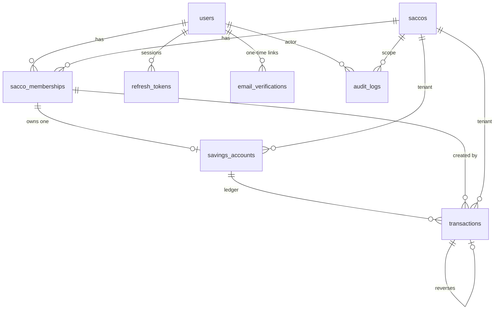

# NEXORA Database Schema (as built)

This is the schema that migrations 0001 to 0009 create in PostgreSQL. It was
generated from a freshly migrated database. The full DDL is in
[schema.sql](schema.sql); this page explains it. It replaces the early
proposal in `database-schema.md`.

To rebuild it: `cd backend && flask --app app db upgrade`.

## Diagram

## Tables

### users
Login identities. A user is not tied to a SACCO here; membership does that.

| Column | Type | Notes |
|---|---|---|
| id | integer PK | |
| email | varchar(255) | unique, case-insensitive (`lower(email)`) |
| password_hash | varchar(255) | Argon2 |
| failed_login_count | integer | default 0, never negative |
| locked_until | timestamptz | set by the lockout rule |
| is_platform_owner | boolean | default false |
| token_version | integer | default 0; raised to kill every access token |
| email_verified_at | timestamptz | null until verified |
| created_at | timestamptz | default now() |

### saccos
The tenants.

| Column | Type | Notes |
|---|---|---|
| id | integer PK | |
| name | varchar(255) | not blank; unique ignoring case and outer spaces |
| status | enum `sacco_status` | `active`, `suspended` |
| currency | varchar(3) | ISO code, default `KES` |
| created_at | timestamptz | |

### sacco_memberships
Links a user to a SACCO with a role.

| Column | Type | Notes |
|---|---|---|
| id | integer PK | |
| user_id | integer FK users | cannot be changed after insert (trigger) |
| sacco_id | integer FK saccos | indexed |
| role | enum `membership_role` | `sacco_admin`, `staff`, `member` |
| status | enum `membership_status` | `active`, `inactive`, default `active` |
| created_at | timestamptz | |

Unique: `(user_id, sacco_id)` and `(id, sacco_id)` (the second one lets other
tables prove a membership belongs to the same SACCO).

### savings_accounts
One account per membership.

| Column | Type | Notes |
|---|---|---|
| id | integer PK | |
| membership_id | integer | unique: one account per membership |
| sacco_id | integer | composite FK `(membership_id, sacco_id)` to memberships |
| balance | bigint | minor units, never negative; maintained by a trigger |
| created_at | timestamptz | |

### transactions (the ledger)
Append-only. Amounts are integers in minor units (KES, 100 = 1.00).

| Column | Type | Notes |
|---|---|---|
| id | integer PK | |
| sacco_id | integer FK saccos | |
| savings_account_id | integer | composite FK `(savings_account_id, sacco_id)` |
| type | enum `transaction_type` | `deposit`, `withdrawal` |
| amount | bigint | greater than 0 |
| reference | varchar(64) | idempotency key; unique per `(sacco_id, reference)` |
| created_by_membership_id | integer | composite FK `(created_by_membership_id, sacco_id)` |
| reverses_id | integer | null, or the entry this one reverses; unique, so an entry is reversed once |
| created_at | timestamptz | indexed with the account |

### audit_logs
Append-only record of who did what.

| Column | Type | Notes |
|---|---|---|
| id | integer PK | |
| sacco_id | integer FK saccos | null for platform-level actions |
| actor_id | integer FK users | null when there is no signed-in user |
| action | varchar(100) | not blank, for example `savings.deposit` |
| target | varchar(255) | what was acted on |
| created_at | timestamptz | |

### refresh_tokens
One row per issued refresh token (they rotate).

| Column | Type | Notes |
|---|---|---|
| id | integer PK | |
| user_id | integer FK users | deleted with the user |
| jti | varchar(64) | unique token id |
| expires_at | timestamptz | indexed |
| revoked_at | timestamptz | set on rotation, logout and password change |
| created_at | timestamptz | |

### email_verifications
One-time links, stored as hashes.

| Column | Type | Notes |
|---|---|---|
| id | integer PK | |
| user_id | integer FK users | deleted with the user |
| token_hash | varchar(64) | unique; the link itself is never stored |
| purpose | varchar(16) | `verify` or `reset` |
| expires_at | timestamptz | |
| created_at | timestamptz | |

## Rules the database enforces itself

These hold even if the application code has a bug.

| Rule | How |
|---|---|
| The ledger cannot be edited, deleted or truncated | triggers `trg_transactions_no_update_delete`, `trg_transactions_no_truncate` |
| The audit log cannot be edited, deleted or truncated | triggers `trg_audit_logs_append_only`, `trg_audit_logs_no_truncate` |
| A balance always equals the sum of its ledger entries | trigger `trg_transactions_apply_balance` updates it on insert; `trg_savings_accounts_guard_balance` refuses any other change |
| Entries are checked on insert (reversal rules, including never reversing a reversal) | trigger `trg_transactions_validate` |
| A membership cannot be moved to another user | trigger `trg_membership_user_immutable` |
| Balance cannot go below zero, amounts must be positive | check constraints |
| A record can only point at records of its own SACCO | composite foreign keys that include `sacco_id` |
| A retried request cannot post twice | unique `(sacco_id, reference)` |
| An entry is reversed at most once | unique `reverses_id` |
| Email and SACCO names are unique ignoring case | unique indexes on `lower(...)` |

## Migrations

| # | What it adds |
|---|---|
| 0001 | Schema v1: the first tables |
| 0002 | Refresh tokens |
| 0003 | Case-insensitive unique email |
| 0004 | Unique SACCO name (ignoring case and spaces, not blank), one savings account per membership |
| 0005 | The ledger drives balances, append-only audit log, value checks, lookup indexes |
| 0006 | Platform owner flag, currency, membership status, ledger actor, reference and reversal |
| 0007 | The ledger refuses a reversal of a reversal |
| 0008 | `token_version` on users, email verification |
| 0009 | `purpose` on one-time links (verify or reset a password) |
