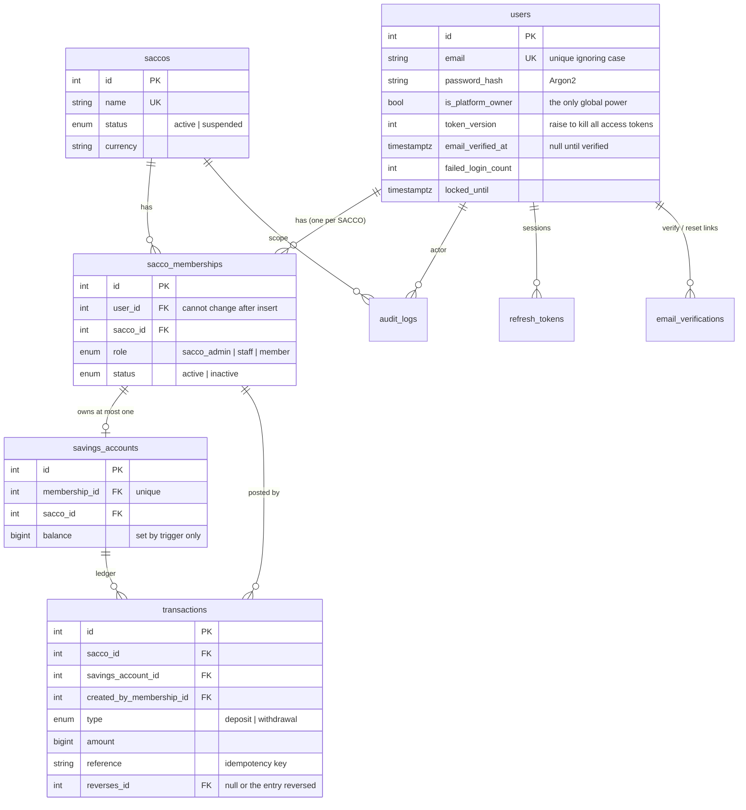
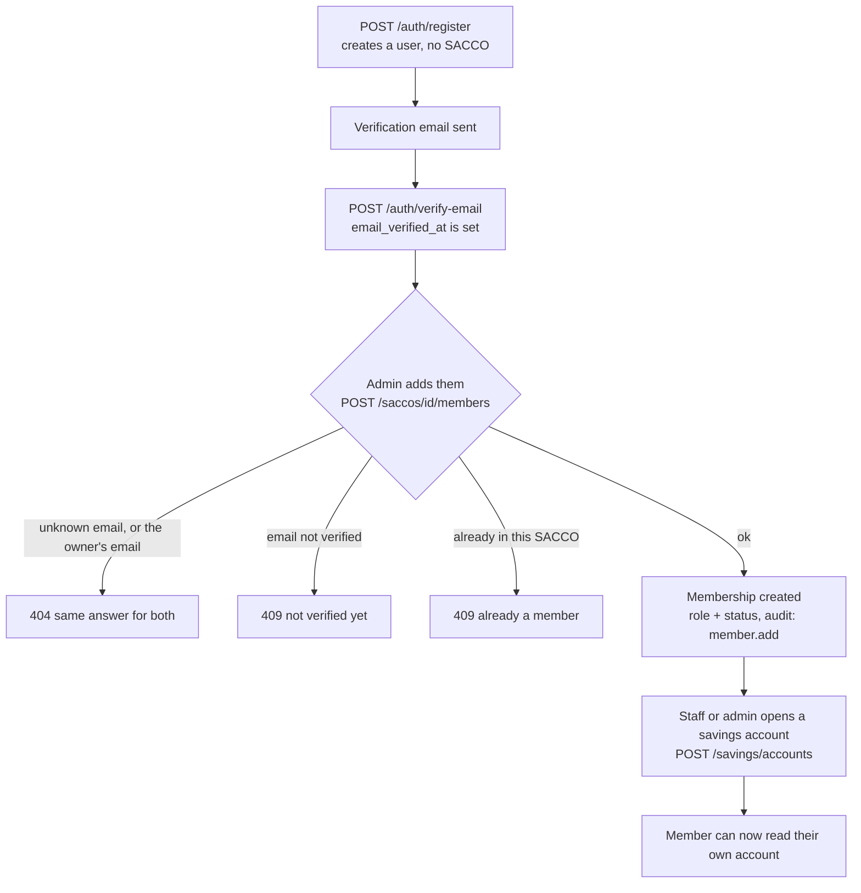
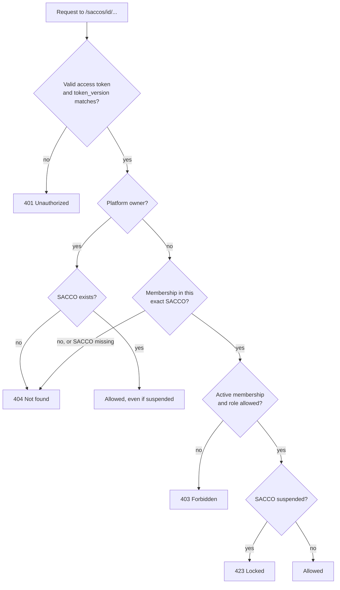

# NEXORA: Users, Members, Roles and Permissions

An entity relationship document (ERD) for how NEXORA decides **who someone is**
and **what they may do**. It is based on the code as built (migrations 0001 to
0009), not on the early proposal. Related: [schema.md](schema.md),
[schema.sql](schema.sql).

## 1. The one idea to remember

NEXORA keeps **identity** and **access** in two different places.

| Concept | Table | Answers the question |
|---|---|---|
| **User** | `users` | Who are you? (email, password, sessions) |
| **Membership** | `sacco_memberships` | Which SACCO are you in, and as what? (role, status) |

A user is not tied to a SACCO. A **membership** is the link between one user and
one SACCO, and it carries the **role**. One person can be a member of several
SACCOs with a different role in each. The only exception is the **platform
owner**, who is a flag on the user and needs no membership at all.

## 2. Entity relationship diagram

Unique `(user_id, sacco_id)` on `sacco_memberships` means a user has **at most one
membership per SACCO**, so there is never a question of which role applies.

## 3. The four kinds of actor

| Actor | How it is stored | Scope |
|---|---|---|
| **Platform owner** | `users.is_platform_owner = true`, no membership | Whole platform |
| **SACCO admin** | membership, `role = sacco_admin` | One SACCO |
| **Staff** | membership, `role = staff` | One SACCO |
| **Member** | membership, `role = member` | One SACCO, own data only |

The platform owner flag is read from the **database on every request**, never
from the token. Revoking it takes effect immediately.

## 4. Lifecycle: how someone becomes a member

Two protections to note:

- **Only verified emails can be added.** Without this, someone could register an
  address they do not own and be handed access to a SACCO.
- **The owner's email looks like an unknown email**, so an admin cannot discover
  the owner's address.

## 5. The checks every request goes through

The tenant guard ([backend/app/security/tenant.py](../backend/app/security/tenant.py))
decides access in one place, in this order:

| Status | Meaning |
|---|---|
| 401 | No token, bad token, or a token killed by password change or logout-all |
| 404 | SACCO missing **or** you are not in it. Same answer, so nothing leaks |
| 403 | You are in the SACCO but inactive, or your role is not allowed |
| 423 | The SACCO is suspended (the platform owner is exempt) |

## 6. Permission matrix

`Yes` = allowed, `Own` = only their own record, `-` = refused.
"Owner" = platform owner.

### Platform and SACCO management

| Action | Endpoint | Owner | Admin | Staff | Member |
|---|---|:-:|:-:|:-:|:-:|
| Create a SACCO | `POST /saccos` | Yes | - | - | - |
| List all SACCOs | `GET /saccos` | Yes | - | - | - |
| Suspend / reactivate a SACCO | `POST /saccos/id/deactivate`, `/activate` | Yes | - | - | - |
| View a SACCO | `GET /saccos/id` | Yes | Yes | - | - |
| Rename a SACCO | `PATCH /saccos/id` | Yes | Yes | - | - |
| Platform-wide audit log | `GET /admin/audit` | Yes | - | - | - |

### Members

| Action | Endpoint | Owner | Admin | Staff | Member |
|---|---|:-:|:-:|:-:|:-:|
| List / view members | `GET /saccos/id/members` | Yes | Yes | - | - |
| Add a **member or staff** | `POST /saccos/id/members` | Yes | Yes | - | - |
| Add / change / deactivate an **admin** | `POST`, `PATCH` members | Yes | - | - | - |
| Change a member or staff role / status | `PATCH /saccos/id/members/mid` | Yes | Yes | - | - |
| Read own profile and memberships | `GET /members/me` | Yes | Yes | Yes | Own |
| Change own email | `PATCH /members/me` | Yes | Yes | Yes | Own |

An admin **cannot touch another admin or themselves**, and cannot promote anyone
to admin. Only the platform owner creates or edits administrators.

### Savings and ledger

| Action | Endpoint | Owner | Admin | Staff | Member |
|---|---|:-:|:-:|:-:|:-:|
| Open a savings account | `POST /savings/accounts` | - | Yes | Yes | - |
| Deposit / withdraw | `POST /savings/accounts/id/deposits`, `/withdrawals` | - | Yes | Yes | - |
| Reverse a transaction | `POST /savings/transactions/id/reversals` | - | Yes | Yes | - |
| Read an account and its history | `GET /savings/accounts/id`, `.../transactions` | Yes | Yes | Yes | Own |
| List own accounts | `GET /savings/accounts/me` | Yes | Yes | Yes | Own |

### Reports and audit (per SACCO)

| Action | Endpoint | Owner | Admin | Staff | Member |
|---|---|:-:|:-:|:-:|:-:|
| Summary, member activity, accounts list | `GET /admin/saccos/id/reports/...`, `/accounts` | Yes | Yes | Yes | - |
| SACCO audit log | `GET /admin/saccos/id/audit` | Yes | Yes | - | - |

### Things that surprise people

1. **The platform owner cannot post money.** Deposits, withdrawals, reversals and
   opening accounts require an *active membership* in the SACCO, and the owner
   has none. The owner manages the platform and can read everything, but never
   moves funds.
2. **Nobody posts on their own account.** An admin or staff member who also holds
   a savings account gets `403` if they try to deposit, withdraw or reverse on it
   (separation of duties).
3. **A member only ever sees their own account.** Asking for someone else's
   account returns `404`, not `403`, so its existence is not revealed.
4. **A suspended SACCO is locked for everyone except the platform owner**, even
   for tokens issued before the suspension. A user whose only active SACCO is
   suspended cannot log in. A user who also has an active SACCO still can.

## 7. Where the rules are enforced

| Layer | What it enforces | Where |
|---|---|---|
| Route guard | Role list per endpoint (`sacco_scoped(roles)`) | [tenant.py](../backend/app/security/tenant.py) |
| Owner guard | `platform_owner_required` | [guards.py](../backend/app/auth/guards.py) |
| Service rules | Posting roles, not on own account, SACCO active | [savings/service.py](../backend/app/savings/service.py) |
| Member rules | Admin changes are owner-only, verified email needed | [members/routes.py](../backend/app/members/routes.py) |
| Database | Membership `user_id` immutable, composite FKs include `sacco_id` so a record can only point inside its own SACCO, ledger and audit log are append-only | [schema.sql](schema.sql) |

Every membership change writes an audit row in the same transaction:
`member.add` and `member.update`, with the before and after state
(for example `membership:7 staff/active -> staff/inactive`).

## 8. Sessions and account safety (the user side)

| Table | Role |
|---|---|
| `refresh_tokens` | One row per session. Rotated on use, revoked on logout and password change |
| `email_verifications` | One-time links stored as hashes. `purpose` is `verify` or `reset` |
| `users.token_version` | Raising it kills every access token at once |
| `users.failed_login_count`, `locked_until` | Lockout after repeated failures |

Changing the password or the email ends all sessions. Ending sessions also
invalidates any pending reset links.

## 9. Demo accounts (from `seed.py`)

| Email pattern | Role |
|---|---|
| the owner address | platform owner |
| `<sacco>-admin@...` | sacco_admin |
| `<sacco>-staff@...` | staff |
| `<sacco>-m1@...`, `-m2@...` | member |
